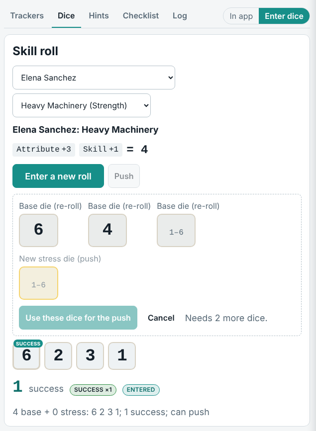
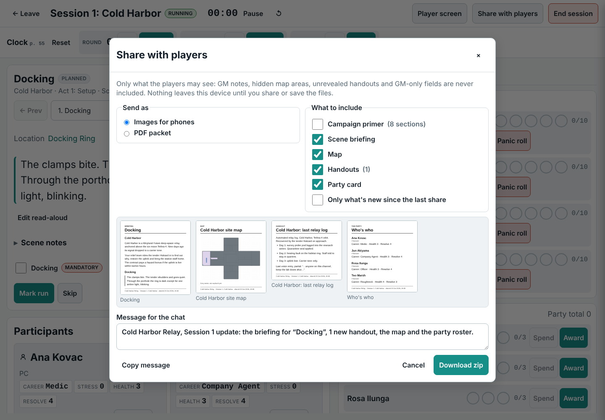
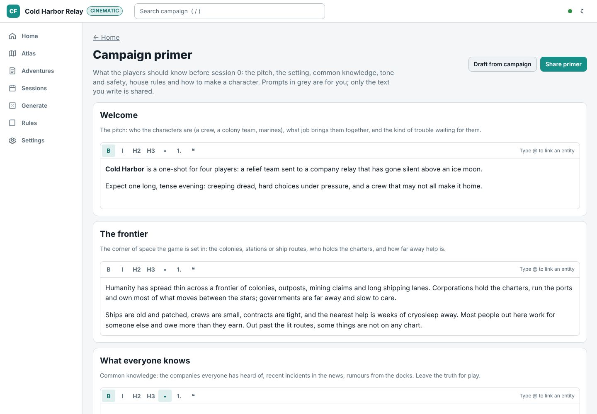
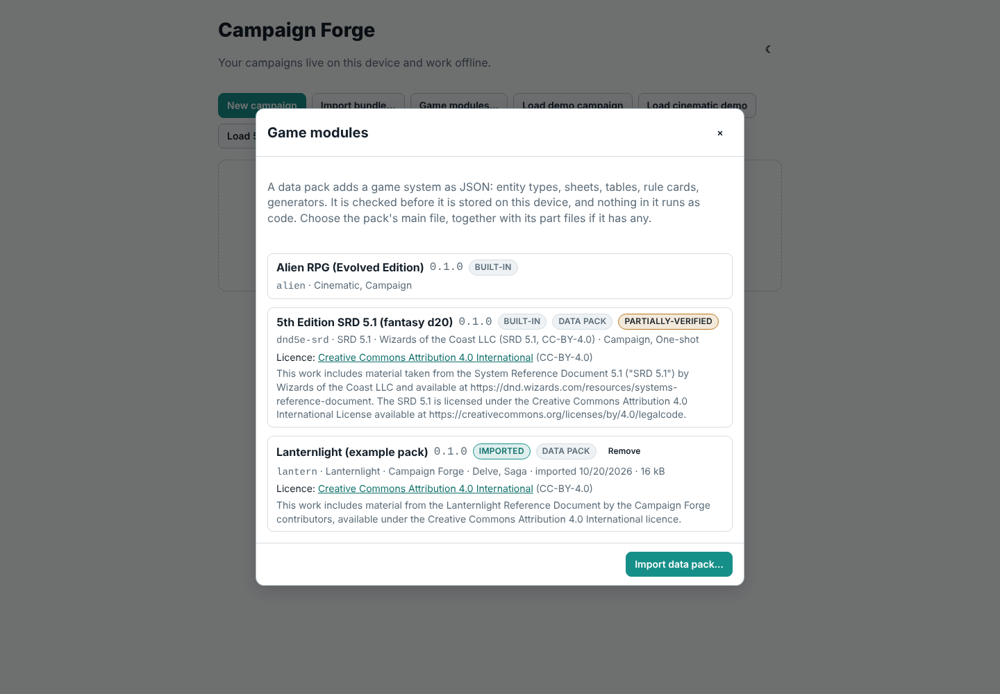
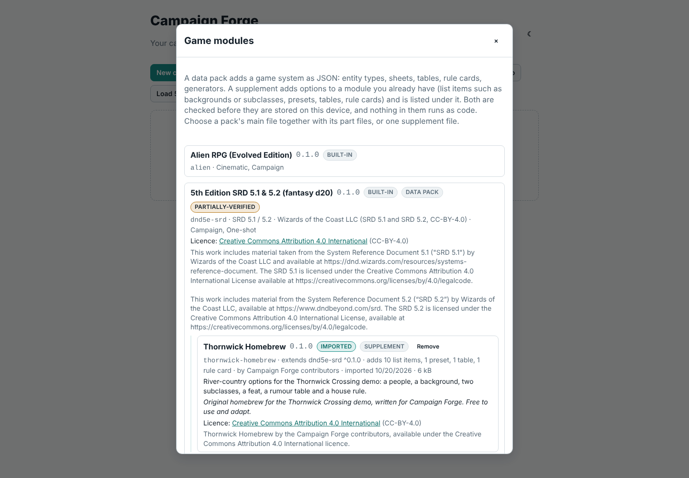

# Campaign Forge

A Game Master's workspace for designing, organizing and running tabletop RPG campaigns. Every game system is a plugin ("module"). Three are built in: the **Alien RPG, Evolved Edition** (Free League, 2025), **5th Edition SRD 5.1 & 5.2 (fantasy d20)**, built on the openly licensed System Reference Documents 5.1 and 5.2, and **Fantasy d20 Remaster (ORC)**, the ORC-licensed core rules compatible with Pathfinder Second Edition (Remaster). Other systems plug in as TypeScript packages or as JSON data packs a GM imports in the app.

For Alien, Campaign Forge is a companion to the rulebook, not a replacement. The module encodes structure, tables and mechanics as data and cites the page; it does not reproduce the book's prose or art. The Alien data has been checked against the printed Evolved Edition core rules; `docs/verification/` records what was corrected, and the few entries the book does not supply remain flagged `unverified`.

## What it does (v1)

- **Local-first PWA.** The campaign lives in the browser (IndexedDB), works offline at the table, and exports to a self-describing zip bundle at any time. No server, no accounts.
- **One place per game system.** The campaign list groups everything by game module: start a campaign, load its demos and open its campaigns from that system's section.
- **Campaign structure.** Adventures, acts, scenes, sessions, timeline, handouts, notes with `@` entity references and backlinks.
- **World entities.** Characters, creatures, locations, factions, items, vehicles, ships, clues, jobs and encounters, each rendered from the module's JSON Schema sheet layout, linked by typed relationships.
- **Generators.** Seeded, re-rollable procedures over the module's tables: world creation, star systems, jobs, life paths, encounter checks, shore leave and between jobs, with full roll provenance.
- **Guided adventure builder.** A step-by-step cinematic scenario builder (basics, situation, cast, locations and puzzles, three acts, review) with a field guide and page references on every step.
- **Table tools.** Scene cards, rounds/stretches/shifts clock, stress and panic roller, critical injuries (including the android table), initiative cards, supply rolls, countdowns, a xenomorph life-cycle tracker and a session checklist that modules extend. A Hints tab says what each attribute and skill is for in the story and rolls it for the best-placed PC.
- **Dice rolled at the table.** For groups who roll physical dice, every roll can take the faces instead: the roll panel, table mode's one-tap rolls (stress, panic, supply, critical injuries, broken and life-cycle checks, creature attacks and reactions, special attacks, duct events, prompt answers), initiative, travel checks and each generator step. One box per die in the order the rules read them, labelled from the dice system (base and stress dice, a d20 pair for advantage, a push's re-rolled dice only), with a 2d6 total, a d66 or a percentile typed as one number; faces the dice cannot show are refused inline. Outcomes, pushes, table rows and effects are exactly an app roll's, and the log marks the roll "entered" with its faces. A switch on each roll surface and in table mode flips between rolling in the app and entering dice; *I roll physical dice* in Settings makes entering the default on that device.
- **Ship and money.** A Ship page for campaign play: the crew's ship with its hull, component damage, spare parts, provisions, cargo and upkeep; crew funds summed from a ledger (add entries, filter by category, running balance, CSV export); a travel planner that works out FTL time and the checks on arrival, then departs, rolls them and moves the in-world date; one-click job payments; and a Between jobs procedure for the pay, the lease, repairs and spare parts, food and water, then shore leave and the next job. Categories the book prices cite their page; docking, fuel and loans are plain GM bookkeeping.
- **Character progression.** An end-of-session award checklist in the wrap-up (the nine XP questions, one column per PC, totals, then Award) and Story Points per act in cinematic play; a Progression tab on each PC with the XP pool, Story Points, lifetime totals and a full history; Spend XP with the book's costs, the level 5 cap, career and general talents, stacking limits and the conditions for a new skill, shown with the dice pool before and after; undo of the last spend; Story Points spent at the table from the PC card or on a roll (one base die becomes a success). Every award and spend is logged per character and travels in the export bundle.
- **Combat.** Creature turns roll or pick the creature's signature attack, rank targets by range from the live map and roll the attack dice; damage tracking with health bars, armor and broken PCs; reactions such as acid splash; special attacks (disarm, shove, grapple and more) with opposed rolls. Creature rolls stay GM-only.
- **Site maps.** A seeded deck-plan generator that reads the adventure's locations, puzzles and crew, draws a floor plan in the shape of the site type (a starship's long spine, a derelict's broken hull, a station's ring, a colony's cluster of prefabs, a mine's winding adit, a lab's wings round an atrium, a ruin's great chambers), checks the map against the zone rules, and produces a GM map, a player map (fogged in play, whole in print), a tracking map, a zone key and a distance table. At the table the GM reveals zones, locks and seals doors, marks fires and pings the tracker; the player screen shows only what the crew has seen.
- **Share with players.** From table mode or a session page, send the player view to the group chat without a server: phone-sized cards (the scene briefing, the map with fog exactly as the player screen shows it, each revealed handout, an optional party card) or one black-and-white PDF packet in Letter or A4. Built from the player projection only (no GM notes, hidden zones, GM map layers, unrevealed or per-player handouts, or GM-only fields), drawn on the device, then handed to the phone's share sheet (Messages, Messenger, WhatsApp) or downloaded as a zip on desktops. Each share is recorded in the session, so the next one can send only what is new, with a ready-to-paste chat message.
- **Campaign primer.** A player-facing introduction for session 0 (the pitch, the setting, what everyone knows, places and factions, tone and safety tools, house rules, making characters, where we begin), edited as rich text with the module's prompts and starter text in original words. *Draft from campaign* fills sections from player-visible places, factions, timeline, characters and the adventure's player intro, never from GM-only records or fields. It is linked from campaign home and session 0, and shared like a session: one phone card per section or pages of the PDF packet. Modules and data packs can supply their own prompts (`primer` in the contract and the pack format).
- **Duct levels.** Ducts are generated as separate maze sheets with labelled exits, shafts between levels, hazards and a GM-only duct event table rolled from table mode.
- **Printed booklets.** A black-and-white GM booklet (Letter or A4) with a title page, cast cards, locations and puzzles, the site map and each act's scenes with boxed read-aloud text, plus cut-out agenda cards for the players.
- **Wide-format printing.** Site maps print on 24" or 36" rolls as vector PDFs at 1 inch per metre (28mm miniatures), 28mm true scale or an overview scale, with a title block, scale bar and optional 1 m grid squares.
- **Maps from images.** Imported images with rectangular zone overlays and open/blocked/door borders.
- **Rules reference.** Rule cards filtered by play mode: paraphrases with page references for Alien, the source's own text cited by section for the fifth edition and ORC modules.
- **Multi-system modules.** Every game system is a module: a TypeScript package, or a declarative JSON data pack (no code) that the SDK turns into one. GMs import packs in the app (*Game modules…* on the campaign list); a pack is validated before it is stored, never runs as code, shows its licence and attribution, and travels inside campaign bundles. Packs pick one of four built-in dice engines: d20 (advantage, disadvantage, DC, optional four degrees of success with natural 20/1 shifts, situational modifier choices), dice pool, 2d6 bands and d100 roll-under. `pnpm create-module` scaffolds a pack or a TypeScript module and `pnpm module-check` validates one or `--all`; the author guide is [docs/modules](docs/modules/README.md).
- **Supplements.** Extra options for a module you already have (backgrounds, subclasses, races, feats, spells, presets, tables, rule cards) as one JSON file of additive data, imported under *Game modules…*. A supplement is checked against the module it extends, merged in when that module loads, listed under it with its notice, marked with a source badge wherever its entries appear, recorded in generator provenance and carried in campaign bundles. Sheet fields suggest list items as you type (the fifth edition sheet's race, subrace, background and subclass), supplement items included, and still take any text. `pnpm create-module --supplement <module>` scaffolds one; [docs/modules/supplements.md](docs/modules/supplements.md) covers the format and keeping private supplements private.
- **Fifth edition (SRD 5.1 and 5.2).** A built-in data pack with the whole SRD 5.1: 334 monster stat blocks as presets, 319 spells, magic items, equipment, classes and races as reference lists, rule cards cited by section, and dice tables. Beside them, the SRD 5.2 character options: 4 backgrounds (ability scores, origin feat, skills, tool, equipment), 9 species with 24 lineages and their traits, 12 subclasses with their features and 17 feats, each with a *2024* and an *SRD 5.2* badge, cited by SRD 5.2 section, and named "Elf (2024)" where the SRD 5.1 has an option of the same name; the sheet suggests both editions and shows a picked background's ability scores and feat under the field. Character sheets derive ability modifiers, proficiency bonus, saves, skills (with expertise), passive scores, initiative and spellcasting numbers; d20 rolls from a sheet or the table take advantage, disadvantage and a DC. Initiative, hit point, death save, spell slot and other trackers, plus original encounter, NPC, settlement and tavern generators and a one-shot template. Not affiliated with Wizards of the Coast; see the licence note below.
- **Second edition remaster (ORC core rules).** A built-in data pack with the ORC-licensed content of Player Core, Player Core 2, GM Core and Monster Core and none of the setting's names: 490 Monster Core stat blocks and 32 hazards as presets; ancestries, heritages, backgrounds, classes, 1,814 feats, 663 spells and 1,243 items as reference lists; every condition and action as a rule card cited by section. Character sheets derive Perception, saves and skills from proficiency ranks (level + 2/4/6/8), class DC, AC, Hit Points, spell DC and Bulk; rolls read four degrees of success (DC ± 10, natural 20 and 1 shift one step) with fortune, misfortune and the multiple attack penalty in the roll panel. An encounter builder spends GM Core's XP budgets on Monster Core creatures; trackers for initiative, Hit Points, dying/wounded/doomed, Hero and Focus Points and valued conditions. Not affiliated with Paizo; see the licence note below.

- **Built-in supplements.** Supplements can ship with the app, optional per device: *Remaster ORC books* adds the ORC content of nine more remaster books to the ORC core rules module (820 creatures and NPCs, 27 hazards, 12 classes, 8 ancestries, feats, spells and items, still without the setting's names). It is listed under its module in *Game modules…* with *Built-in* and *Supplement* badges and an on/off switch (off by default; it roughly doubles the module's data), merged in when the module loads while it is on, marked with its source badge, and named, not embedded, in exported bundles, so importing one switches it on. A large supplement can be split into a main file and parts.

## Screenshots

Four demo campaigns load from the campaign list: *Skyfire Down* (Alien campaign play, with an infection under way), *Cold Harbor Relay*, an Alien cinematic one-shot built with the guided builder, with a generated site map, duct levels and live map state ready for session 1, *Thornwick Crossing*, a fifth edition one-shot on the SRD module (SRD 5.1 characters) with four level 3 characters, SRD monsters and a goblin ambush ready for table mode, and *Hollowmere*, a second edition remaster one-shot on the ORC core rules module with four level 1 characters, kobold oil thieves and a xulgath den.

**Campaign list**: each game system has its own section with a button to start a campaign, its demos and the campaigns that use it; import and game modules stay at the top.


**Campaign home**: next session, adventures and open hooks.


**Character sheet**: rendered from the module's schema; computed values such as Health and Resolve are derived, never stored.


**Generators**: every step shows its roll and page; re-roll any step, then accept the result into the campaign.


**Table mode**: the scene card, the clock, crew funds and the ship at a glance, stress and panic for each PC, countdowns and the session checklist.


**Table hints**: for each attribute and skill, the story moments that call for it, what success, failure and a push should do to the scene, lines to say aloud, and the PCs ranked by how good their roll is, best and worst marked; tap one to roll on the spot.


**Dice rolled at the table**: table mode set to *Enter dice*: the skill roll took the four base dice as typed (one success, marked "entered"), and the push asks only for the three dice it re-rolls and its new stress die.



**Creature turns**: roll or choose a creature's signature attack, pick a target by range from the live map, roll the dice and apply the damage; armor, acid splash and broken rolls are worked out for you, all GM-only.


**Guided adventure builder**: the cinematic scenario steps with the field guide and what still needs fixing.


**Site map generator**: the brief is filled from the adventure (key rooms, puzzles, NPCs) and every map is checked against the zone rules.


**GM map**: zone numbers, ducts, spawns, clues, hazards, locks and act shading, with the legend and the rule each symbol carries.


**Player map**: the same deck with every GM detail removed; it prints whole at 1 m = 1 cm, and at the table the player screen adds fog.


**Site types**: each site type has its own floor plan from the same brief: a starship along one spine, a derelict with breached and collapsed sections, a station ring round a hub, colony prefabs on open yards, a mine's winding adit, a lab's mirrored wings behind decon locks, and a ruin's great halls joined by galleries.


**Roll print**: a 36" wide-format vector PDF at 1 inch per metre for 28mm miniatures, turned to fit the roll with all text upright, with a title block, 5 m scale bar and zone key in the margin. Decks too wide for the roll split into overlapping strips with cut lines.


**Printed booklet**: the adventure as a black-and-white GM booklet for Letter or A4: a title page with the key facts and contents, then the cast, locations with their puzzles, the site map, and each act with its pacing, agendas and numbered scenes, with boxed read-aloud text, grey GM-only boxes, page numbers and a running header.


**Agenda cards**: one cut-out card per character per act, four to a page with crop marks, handed to each player as the act begins.


**Share with players**: the player-safe share of a session, previewed as the phone cards it sends (briefing, fogged map, revealed handout, party), with what to include, "only what's new" and the message for the chat.



**Campaign primer**: Cold Harbor's session 0 introduction, with the module's prompt above each section, the demo's own text and the places drafted from player-visible locations; *Share primer* sends it as phone cards or a PDF.



**Duct level**: each deck's ducts are generated as their own maze sheet, with runs, junctions, vent chambers and shafts that climb or drop between levels. Exits are labelled with the room they open into, generated hazards (vent fans, steam, flooding, collapses, drops) sit in the maze, and a GM-only duct event table rolls encounters, dangers and moments of respite at the table. Players see a duct zone only once the crew reaches it.


**Ship and money**: the crew's ship and its state, crew funds summed from the ledger, Between jobs, and the travel planner with the days, NDD rolls, hypersleep and food the trip calls for.


**Wrap-up awards**: the nine end-of-session XP questions for every PC at once, with attendance ticked, questions that do not apply greyed out (no buddy, no rival) and each PC's new total before posting.


**Progression and Spend XP**: a PC's XP pool and history beside the Spend XP panel, with each skill's cost, its dice before and after, and the condition a new skill needs.


**Rules reference**: short paraphrases with printed page references.


**Game modules**: the built-in Alien and SRD 5.1 modules beside a data pack imported on this device, each with its licence and attribution.



**Supplements**: an original homebrew supplement imported for the SRD 5.1 module, listed under it with what it adds, its notice and its licence.



**Fifth edition sheet**: a level 3 wizard from *Thornwick Crossing*; the scores and proficiencies are written down, and the modifiers, proficiency bonus, initiative, hit dice and save bonuses are computed.


**d20 rolls**: a Stealth check with expertise rolled from the sheet with advantage against a DC, showing the bonus breakdown, the dropped die, the total and the outcome.


**Fifth edition table**: the opening ambush with rolled initiative, highest first, and hit points for the party and the goblins in the scene.


**Fifth edition hints**: each ability check, skill and saving throw with its story cues, and the party ranked by their d20 bonus (ability, proficiency and expertise), best and worst marked.


**SRD 5.1 and 5.2 options**: the SRD 5.1 Acolyte, the SRD 5.2 backgrounds with their ability scores and origin feats (badged *2024* and *SRD 5.2*, with "(2024)" where a name repeats) and the demo supplement's Ferrywright in one list.


**Remaster sheet**: a level 1 cleric from *Hollowmere*; attribute modifiers and proficiency ranks are written down, and every check total, AC, Hit Points, class DC and spell DC is computed.


**Four degrees of success**: a Stealth check rolled with fortune against a DC and beaten by 10 or more: a critical success.


**Encounter builder**: a severe encounter for four level 3 characters, GM Core's XP budget spent on Monster Core creatures by level.


**Built-in supplement**: *Remaster ORC books* switched on under Game modules; Hollowmere's ancestries list gains eight from Howl of the Wild, Guns & Gears and Battlecry!, each with its source badge and citation.


## Repository layout

```
packages/module-sdk     the GameModule contract and runtime (dice, tables, procedures, conformance)
packages/core           game-agnostic domain model, Yjs store, persistence, visibility, search, bundles
packages/module-alien   the Alien RPG module: data, procedures, templates, rule cards
packages/module-dnd5e-srd the 5th Edition SRD 5.1 & 5.2 module, a built-in JSON data pack
packages/module-pf2e-orc  the Fantasy d20 Remaster (ORC) module, a built-in JSON data pack of the ORC core rules
packages/module-example a tiny fixture module (and fixture data pack) the core and UI are tested against
packages/ui             schema-driven sheet renderer, widgets, trackers, map editor and site map renderer
apps/web                the React 19 + Vite PWA
tools/table-lint        dice coverage, page refs, data-status report, spot-check sheets
tools/seed-campaign     builds the demo campaigns
tools/module-check      validates a module, data pack or supplement (pnpm module-check --all)
tools/create-module     scaffolds a new module, data pack or supplement
tools/docs-check        README screenshots are present, used and small enough
docs/                   architecture seed, module author guide, verification notes, screenshots
```

## Getting started

```
pnpm install
pnpm dev          # web app on http://localhost:5173
pnpm test         # unit tests and module conformance
pnpm typecheck
pnpm table-lint   # lints every table in every module
pnpm screenshots  # builds the app and regenerates every README screenshot from the demo campaigns
```

Re-run one screenshot by name once the app is built: `pnpm --filter @campaign-forge/web screenshots -g creature-turn`. Images go to `docs/screenshots/` (or `SCREENSHOTS_DIR`).

## Licensing note

The 5th Edition SRD 5.1 & 5.2 module (`packages/module-dnd5e-srd`) includes material from the SRD 5.1 and the SRD 5.2 under the Creative Commons Attribution 4.0 International licence; its attributions, shown in the app wherever the module's licence appears:

> This work includes material taken from the System Reference Document 5.1 ("SRD 5.1") by Wizards of the Coast LLC and available at https://dnd.wizards.com/resources/systems-reference-document. The SRD 5.1 is licensed under the Creative Commons Attribution 4.0 International License available at https://creativecommons.org/licenses/by/4.0/legalcode.

> This work includes material from the System Reference Document 5.2 (“SRD 5.2”) by Wizards of the Coast LLC, available at https://www.dndbeyond.com/srd. The SRD 5.2 is licensed under the Creative Commons Attribution 4.0 International License, available at https://creativecommons.org/licenses/by/4.0/legalcode.

The module is compatible with fifth edition rules and is not affiliated with, endorsed, sponsored or approved by Wizards of the Coast LLC. Its JSON structure derives from 5e-bits/5e-database (MIT); see the module's [NOTICE](packages/module-dnd5e-srd/NOTICE). The *Thornwick Crossing* demo is original content.

The Fantasy d20 Remaster (ORC) module (`packages/module-pf2e-orc`) includes material from Player Core, Player Core 2, GM Core and Monster Core under the ORC License, and only entries the source marks as ORC-licensed and remastered. Its notices, shown in the app wherever the module's licence appears and in full in its [NOTICE](packages/module-pf2e-orc/NOTICE):

> **ORC Notice.** This product is licensed under the ORC License located at the Library of Congress at TX 9-307-067 and available online at various locations. All warranties are disclaimed as set forth therein.
>
> **Attribution Notice.** This product includes material from Pathfinder Player Core © 2023, Paizo Inc.; Pathfinder Player Core 2 © 2024, Paizo Inc.; Pathfinder GM Core © 2023, Paizo Inc.; and Pathfinder Monster Core © 2024, Paizo Inc. (the full designer and author credits are in the module's NOTICE and manifest).

None of the publisher's Reserved Material is used: the converter drops or rewrites the setting's proper nouns (deities, places, planes, organizations, characters) and the tests check none remain. Compatible with Pathfinder Second Edition (Remaster). Not affiliated with or endorsed by Paizo Inc. Pathfinder is a trademark of Paizo Inc. Its JSON structure derives from the Foundry VTT pf2e system (Apache-2.0). The *Hollowmere* demo is original content.

Its built-in supplement *Remaster ORC books* (`packages/module-pf2e-orc/supplements/`, off unless the GM switches it on) includes material from Monster Core 2, NPC Core, Howl of the Wild, Treasure Vault (Remastered), Battlecry!, Impossible Magic, Guns & Gears (Remastered), Dark Archive (Remastered) and War of Immortals under the ORC License, again only entries the source marks as ORC-licensed and remastered (Rage of Elements is marked OGL there, so none of it is used), with the same ORC Notice, each book's Attribution Notice (in its manifest and its [NOTICE](packages/module-pf2e-orc/supplements/NOTICE); seven are incomplete in the source and marked TODO for the owner), the same disclaimer, and none of the setting's names (the module's Reserved Material list grew to 433 terms for these books).

Alien is the property of 20th Century Studios, licensed to Free League Publishing. This project contains structure and short paraphrased reference data intended for owners of the rulebook. It is not affiliated with or endorsed by either company. Review `docs/architecture-seed.md` (section "Risks, open questions, and licensing") before any public release.
