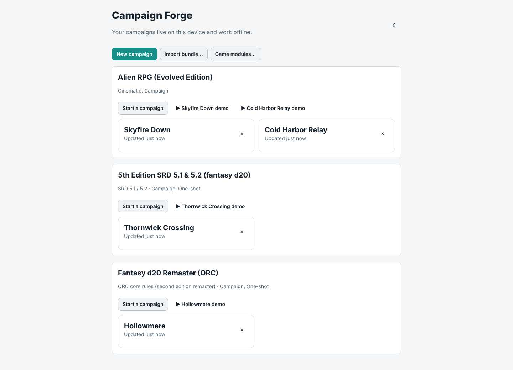

# Campaign Forge

A Game Master's workspace for designing, organizing and running tabletop RPG campaigns. Every game system is a plugin ("module"). Three are built in: the **Alien RPG, Evolved Edition** (Free League, 2025), **5th Edition SRD 5.1 & 5.2 (fantasy d20)**, built on the openly licensed System Reference Documents 5.1 and 5.2, and **Fantasy d20 Remaster (ORC)**, the ORC-licensed core rules compatible with Pathfinder Second Edition (Remaster). Other systems plug in as TypeScript packages or as JSON data packs a GM imports in the app.

For Alien, Campaign Forge is a companion to the rulebook, not a replacement. The module encodes structure, tables and mechanics as data and cites the page; it does not reproduce the book's prose or art. The Alien data has been checked against the printed Evolved Edition core rules; `docs/verification/` records what was corrected, and the few entries the book does not supply remain flagged `unverified`.

## What it does

- **Local-first.** Campaigns live in the browser, work offline at the table and export to a zip bundle. No server, no accounts.
- **Prep.** Adventures, scenes, sessions, a timeline, handouts and linked notes; characters and places rendered from each game's sheet; seeded generators with full roll provenance; printed GM booklets.
- **At the table.** Scene cards, clocks, initiative, trackers and a Hints tab that says what each stat is for in the story and who is best at it. Roll in the app or type in the physical dice your table rolled.
- **For the players.** A session 0 campaign primer, and *Share with players*: the player view as phone cards or a PDF for the group chat, with nothing GM-only in it.
- **Any game system.** Modules as TypeScript packages or JSON data packs, four dice engines, supplements for extra options, and tools to build and check your own ([author guide](docs/modules/README.md)).

More in **[App features](docs/features/app.md)**.




## Game systems

| Module | What it adds | Demos |
|---|---|---|
| **[Alien RPG (Evolved Edition)](docs/features/alien.md)** | Guided cinematic builder, creature turns and combat, the ship and crew funds, XP and Story Points, generated deck plans with ducts, roll printing for miniatures | Skyfire Down, Cold Harbor Relay |
| **[5th Edition SRD 5.1 & 5.2](docs/features/dnd5e.md)** | 334 monsters, 319 spells, sheets with every modifier computed, d20 rolls with advantage, SRD 5.2 backgrounds, species and subclasses | Thornwick Crossing |
| **[Fantasy d20 Remaster (ORC)](docs/features/orc.md)** | 490 creatures, four degrees of success, an XP-budget encounter builder, an optional supplement with nine more remaster books | Hollowmere |


## Repository layout

```
packages/module-sdk     the GameModule contract and runtime (dice, tables, procedures, conformance)
packages/core           game-agnostic domain model, Yjs store, persistence, visibility, search, bundles
packages/module-alien   the Alien RPG module: data, procedures, templates, rule cards
packages/module-dnd5e-srd the 5th Edition SRD 5.1 & 5.2 module, a built-in JSON data pack
packages/module-pf2e-orc  the Fantasy d20 Remaster (ORC) module, a built-in JSON data pack of the ORC core rules
packages/module-example a tiny fixture module (and fixture data pack) the core and UI are tested against
packages/ui             schema-driven sheet renderer, widgets, trackers, map editor and site map renderer
apps/web                the React 19 + Vite PWA
tools/table-lint        dice coverage, page refs, data-status report, spot-check sheets
tools/seed-campaign     builds the demo campaigns
tools/module-check      validates a module, data pack or supplement (pnpm module-check --all)
tools/create-module     scaffolds a new module, data pack or supplement
tools/docs-check        screenshots in the README and docs/features are present, used and small; local links resolve
docs/                   feature pages (docs/features), architecture seed, module author guide, verification notes, screenshots
```

## Getting started

```
pnpm install
pnpm dev          # web app on http://localhost:5173
pnpm test         # unit tests and module conformance
pnpm typecheck
pnpm table-lint   # lints every table in every module
pnpm screenshots  # builds the app and regenerates every screenshot (README and docs/features) from the demo campaigns
```

Re-run one screenshot by name once the app is built: `pnpm --filter @campaign-forge/web screenshots -g creature-turn`. Images go to `docs/screenshots/` (or `SCREENSHOTS_DIR`).

## Licensing note

Each module's page carries its full licence and attribution, which the app also shows wherever the module's licence appears:

- **5th Edition SRD 5.1 & 5.2:** material from the SRD 5.1 and SRD 5.2 by Wizards of the Coast LLC under CC-BY-4.0; [attribution](docs/features/dnd5e.md#licence) and [NOTICE](packages/module-dnd5e-srd/NOTICE). Not affiliated with Wizards of the Coast.
- **Fantasy d20 Remaster (ORC):** material from Paizo's remaster core books under the ORC License, without Reserved Material; [notices](docs/features/orc.md#licence) and [NOTICE](packages/module-pf2e-orc/NOTICE). Not affiliated with or endorsed by Paizo Inc. Pathfinder is a trademark of Paizo Inc.
- **Alien RPG:** Alien is the property of 20th Century Studios, licensed to Free League Publishing. This project contains structure and short paraphrased reference data intended for owners of the rulebook. It is not affiliated with or endorsed by either company. Review `docs/architecture-seed.md` (section "Risks, open questions, and licensing") before any public release.

