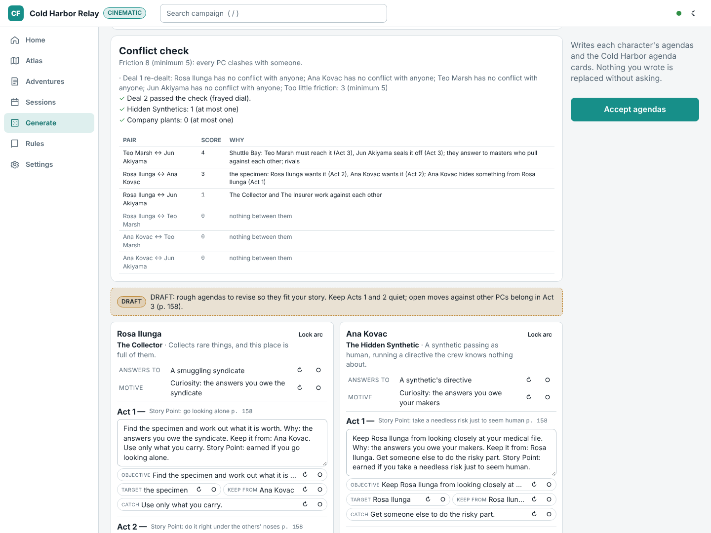
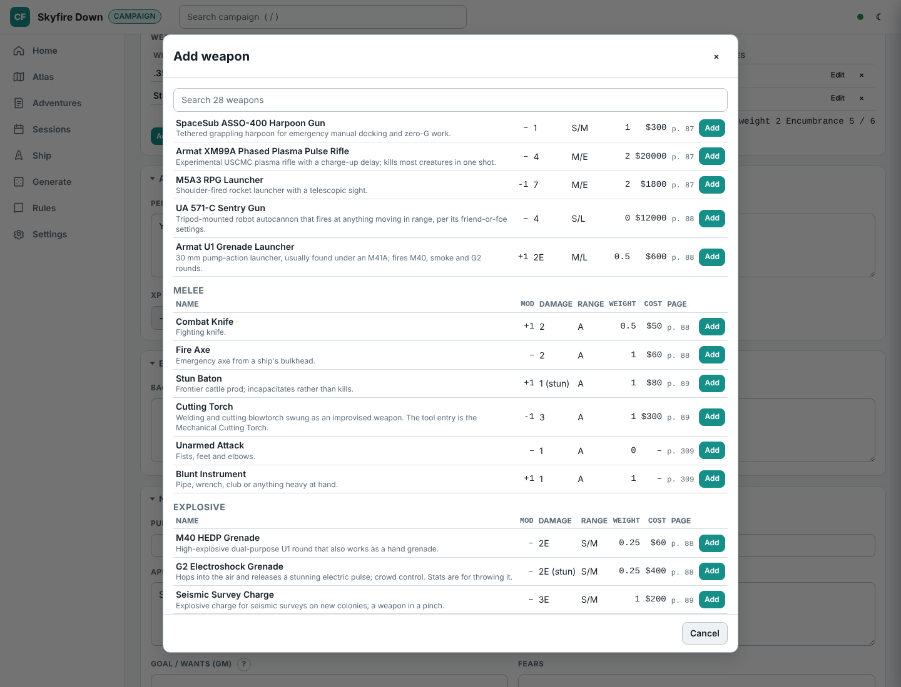

# Alien RPG (Evolved Edition)

[Campaign Forge](../../README.md) · [App features](app.md) · [Alien RPG](alien.md) · [Fifth edition](dnd5e.md) · [Remaster (ORC)](orc.md)

The `alien` module (`packages/module-alien`): a companion to the Free League rulebook, not a replacement. It encodes structure, tables and mechanics as data and cites the page; it does not reproduce the book's prose or art. The data has been checked against the printed Evolved Edition core rules; [`docs/verification/`](../verification/README.md) records what was corrected.

Demos: *Skyfire Down* (campaign play, with an infection under way) and *Cold Harbor Relay* (a cinematic one-shot built with the guided builder, with a generated site map, duct levels and live map state ready for session 1).

## What it adds

- **Guided adventure builder.** A step-by-step cinematic scenario builder (basics, situation, cast, locations and puzzles, three acts, review) with a field guide and page references on every step.
- **Agenda drafts.** A generator for cinematic play (no AI) that deals each PC one of 24 original three-act arcs (The Plant, The Debtor, The Protector, The Hidden Synthetic, The Mutineer…) weighted by a betrayal dial (loyal crew, frayed, knives out), and fills every slot from the campaign: who they answer to (the Company the adventure names, a rival corporation, the marshals, family, a belief, a synthetic's directive…), why, an objective per act aimed at the adventure's PCs (buddies and rivals), NPCs, key items, locations and site map rooms (fallbacks such as "the specimen" when the campaign has none), who to keep it from, and a catch. Objectives escalate from quiet in Acts 1-2 to open in Act 3 and aim at the climax, and each act notes how pursuing it earns the act's Story Point (risk or sacrifice, p. 158). A conflict check scores every pair (opposed objectives on the same target, competing masters, rivals), caps the party at one Hidden Synthetic and one Company plant, wants every PC in a clash and enough friction, and re-deals (seeded) when the deal fails, reporting each try. The drafts are marked DRAFT: re-roll or pin any slot, lock an arc, edit the text, then *Accept agendas* writes them onto each PC's sheet and the adventure's agenda cards, asking before it replaces text you wrote. Open it from the guided builder's PCs step or the Generate page.
- **Combat.** Creature turns roll or pick the creature's signature attack, rank targets by range from the live map and roll the attack dice; damage tracking with health bars, armor and broken PCs; reactions such as acid splash; special attacks (disarm, shove, grapple and more) with opposed rolls. Creature rolls stay GM-only.
- **Weapons on the character sheet.** A Weapons section beside Gear lists each weapon with its stat line as the gear tables print it (modifier, damage with E, stun or fire, range, ammo or power, features, weight), and the weapons count toward encumbrance with the gear. *Add weapon* opens a searchable picker of the book's personal weapons grouped ranged, melee and explosive (vehicle-mounted guns left out), each with modifier, damage, range, weight, cost and page; picking one copies its stats onto the sheet. *From campaign items* links a weapon item from the Atlas, and *Custom weapon* adds a row to fill in. A new PC or NPC created in the Atlas can pick starting weapons before it is saved. At the table, *Attack with …* (Dice tab, or the PC card's Attack button) rolls Close Combat at Adjacent range and Ranged Combat beyond, with the weapon's modifier and −2 per band inside its minimum range, shows the damage with extra successes, and applies the hit to a creature or NPC through its armor (armor piercing, stun and fire included); entered dice work too.
- **Ship and money.** A Ship page for campaign play: the crew's ship with its hull, component damage, spare parts, provisions, cargo and upkeep; crew funds summed from a ledger (add entries, filter by category, running balance, CSV export); a travel planner that works out FTL time and the checks on arrival, then departs, rolls them and moves the in-world date; one-click job payments; and a Between jobs procedure for the pay, the lease, repairs and spare parts, food and water, then shore leave and the next job. Categories the book prices cite their page; docking, fuel and loans are plain GM bookkeeping.
- **Character progression.** An end-of-session award checklist in the wrap-up (the nine XP questions, one column per PC, totals, then Award) and Story Points per act in cinematic play; a Progression tab on each PC with the XP pool, Story Points, lifetime totals and a full history; Spend XP with the book's costs, the level 5 cap, career and general talents, stacking limits and the conditions for a new skill, shown with the dice pool before and after; undo of the last spend; Story Points spent at the table from the PC card or on a roll (one base die becomes a success). Every award and spend is logged per character and travels in the export bundle.
- **Site maps.** A seeded deck-plan generator that reads the adventure's locations, puzzles and crew, draws a floor plan in the shape of the site type (a starship's long spine, a derelict's broken hull, a station's ring, a colony's cluster of prefabs, a mine's winding adit, a lab's wings round an atrium, a ruin's great chambers), checks the map against the zone rules, and produces a GM map, a player map (fogged in play, whole in print), a tracking map, a zone key and a distance table. At the table the GM reveals zones, locks and seals doors, marks fires and pings the tracker; the player screen shows only what the crew has seen.
- **Duct levels.** Ducts are generated as separate maze sheets with labelled exits, shafts between levels, hazards and a GM-only duct event table rolled from table mode.
- **Wide-format printing.** Site maps print on 24" or 36" rolls as vector PDFs at 1 inch per metre (28mm miniatures), 28mm true scale or an overview scale, with a title block, scale bar and optional 1 m grid squares.

The app-wide features (table mode, hints, generators, sharing, booklets) work with this module too; see [App features](app.md).

## Screenshots

**Guided adventure builder**: the cinematic scenario steps with the field guide and what still needs fixing.

**Agenda drafts**: the party's arcs dealt from the Cold Harbor adventure with the conflict report (friction per pair, the caps, the re-deals), then each PC's three acts as editable drafts whose slots re-roll or pin one by one.

**Agenda cards**: one cut-out card per character per act, four to a page with crop marks, handed to each player as the act begins.

**Creature turns**: roll or choose a creature's signature attack, pick a target by range from the live map, roll the dice and apply the damage; armor, acid splash and broken rolls are worked out for you, all GM-only.

**Add weapon**: the picker on a PC's sheet, grouped ranged, melee and explosive, with each weapon's modifier, damage, range, weight, cost and page; one click copies the stat line into the sheet's Weapons section.

**Ship and money**: the crew's ship and its state, crew funds summed from the ledger, Between jobs, and the travel planner with the days, NDD rolls, hypersleep and food the trip calls for.

**Wrap-up awards**: the nine end-of-session XP questions for every PC at once, with attendance ticked, questions that do not apply greyed out (no buddy, no rival) and each PC's new total before posting.

**Progression and Spend XP**: a PC's XP pool and history beside the Spend XP panel, with each skill's cost, its dice before and after, and the condition a new skill needs.

**Site map generator**: the brief is filled from the adventure (key rooms, puzzles, NPCs) and every map is checked against the zone rules.

**GM map**: zone numbers, ducts, spawns, clues, hazards, locks and act shading, with the legend and the rule each symbol carries.

**Player map**: the same deck with every GM detail removed; it prints whole at 1 m = 1 cm, and at the table the player screen adds fog.

**Site types**: each site type has its own floor plan from the same brief: a starship along one spine, a derelict with breached and collapsed sections, a station ring round a hub, colony prefabs on open yards, a mine's winding adit, a lab's mirrored wings behind decon locks, and a ruin's great halls joined by galleries.

**Duct level**: each deck's ducts are generated as their own maze sheet, with runs, junctions, vent chambers and shafts that climb or drop between levels. Exits are labelled with the room they open into, generated hazards (vent fans, steam, flooding, collapses, drops) sit in the maze, and a GM-only duct event table rolls encounters, dangers and moments of respite at the table. Players see a duct zone only once the crew reaches it.

**Roll print**: a 36" wide-format vector PDF at 1 inch per metre for 28mm miniatures, turned to fit the roll with all text upright, with a title block, 5 m scale bar and zone key in the margin. Decks too wide for the roll split into overlapping strips with cut lines.

## Licence

Alien is the property of 20th Century Studios, licensed to Free League Publishing. This project contains structure and short paraphrased reference data intended for owners of the rulebook. It is not affiliated with or endorsed by either company. Review `docs/architecture-seed.md` (section "Risks, open questions, and licensing") before any public release.
