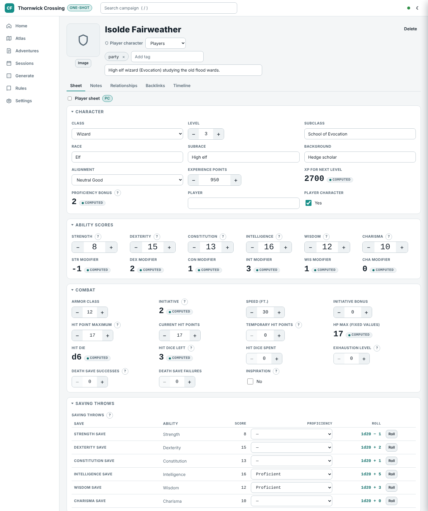
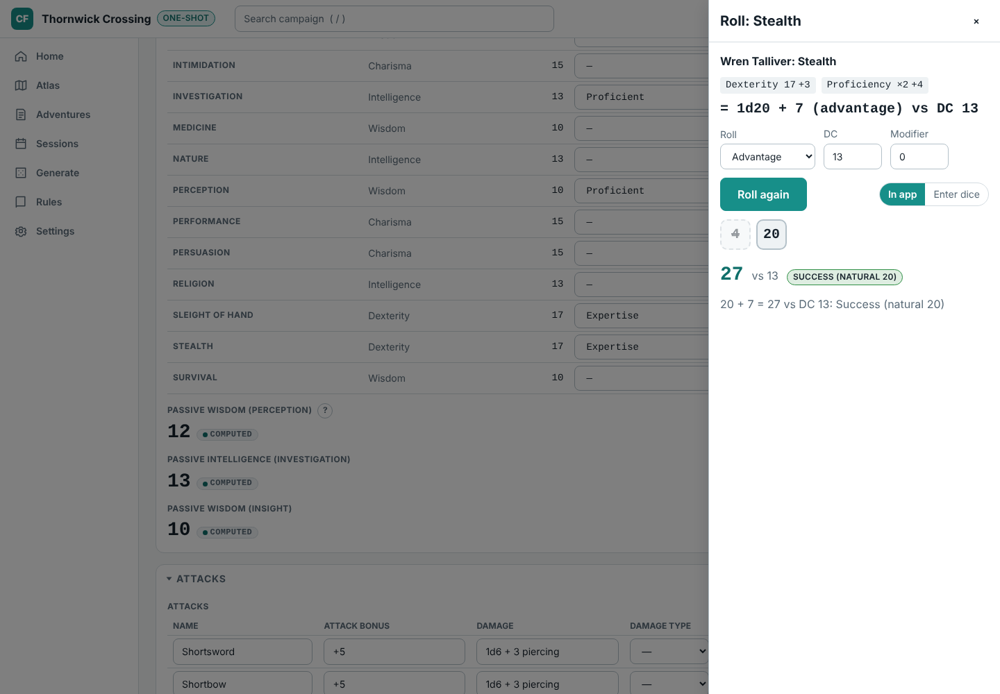
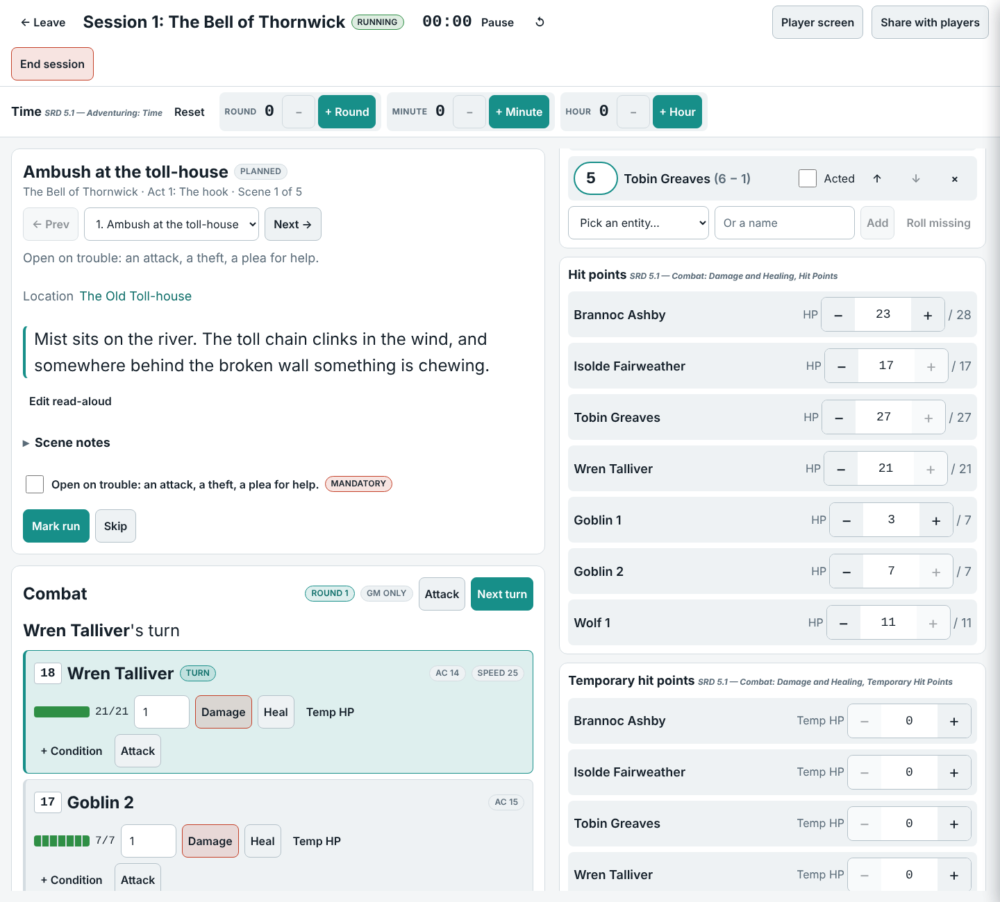
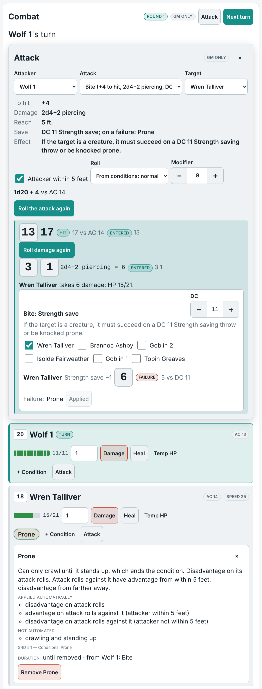
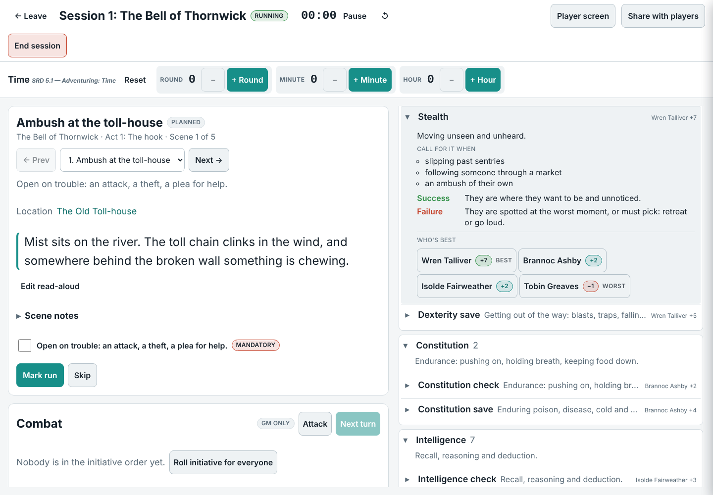
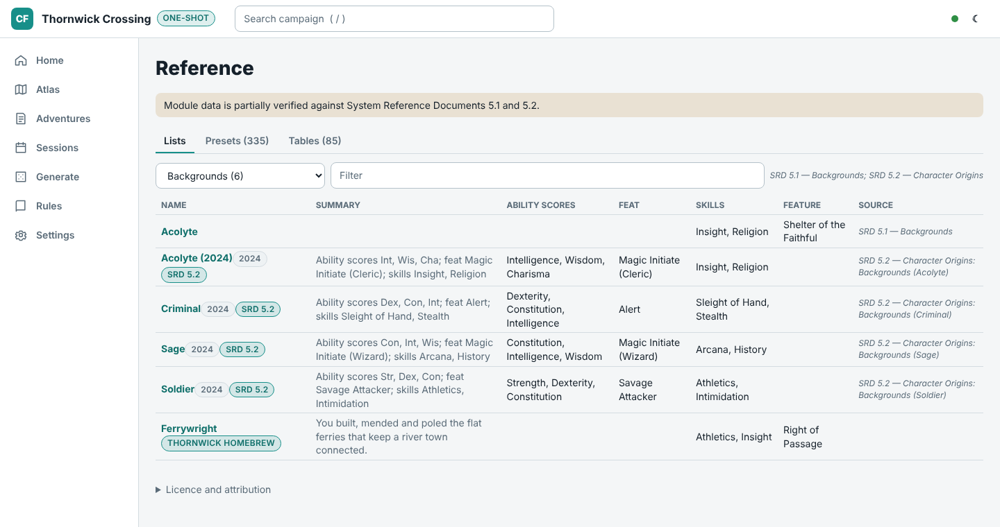

# 5th Edition SRD 5.1 & 5.2 (fantasy d20)

[Campaign Forge](../../README.md) · [App features](app.md) · [Alien RPG](alien.md) · [Fifth edition](dnd5e.md) · [Remaster (ORC)](orc.md)

The `dnd5e-srd` module (`packages/module-dnd5e-srd`), a built-in JSON data pack built from the openly licensed System Reference Documents 5.1 and 5.2.

Demo: *Thornwick Crossing*, a one-shot with four level 3 characters (SRD 5.1), SRD monsters and a goblin ambush ready for table mode, plus an original homebrew supplement.

## What it adds

- **The whole SRD 5.1.** 334 monster stat blocks as presets, 319 spells, magic items, equipment, classes and races as reference lists, rule cards cited by section, and the SRD's dice tables.
- **SRD 5.2 character options.** 4 backgrounds (ability scores, origin feat, skills, tool, equipment), 9 species with 24 lineages and their traits, 12 subclasses with their features and 17 feats, each badged *2024* and *SRD 5.2*, named "Elf (2024)" where SRD 5.1 has an option of the same name.
- **Character sheets.** Ability modifiers, proficiency bonus, saves, skills (with expertise), passive scores, initiative and spellcasting numbers are all derived. Race, subrace, background and subclass suggest options from both editions (and any supplement) and show a picked background's ability scores and feat.
- **d20 rolls.** From a sheet or the table, with advantage, disadvantage and a DC; the Hints tab ranks the party by bonus for every check and save.
- **At the table.** Initiative, hit point, death save, spell slot, exhaustion and other trackers.
- **Combat.** The table's combat panel runs fights from the SRD's own numbers: every monster's attacks as structured data (330 of 334 stat blocks: attack bonus, damage dice and types, reach and range, and 195 save effects such as a dragon's breath or a ghoul's paralyzing claws, with their DC, half damage and conditions), resistances, immunities and vulnerabilities by damage type (with "nonmagical", "silvered" and "adamantine" exceptions), and the attack rows on a character sheet (now with a damage type and melee, ranged or spell). A natural 20 hits and rolls the damage dice twice, a natural 1 misses; a character at 0 hit points falls unconscious (death saves on the tracker), a monster is defeated.
- **The 15 conditions with helper text.** Each says what it does (the SRD's words, shortened) and what the app applies by itself: advantage and disadvantage on attack rolls, checks and saves (poisoned, prone, restrained, blinded, invisible, frightened, exhaustion by level), attacks against it (prone within 5 feet or farther away, paralyzed and unconscious close hits made critical), automatic failure of Strength and Dexterity saves, speed 0 or halved, and the conditions each one brings (unconscious: incapacitated and prone); the rest is listed as not automated.
- **Original GM tools.** Encounter, NPC, settlement and tavern generators, tables and a one-shot template, marked *Original*.
- Not affiliated with Wizards of the Coast; see the [licence](#licence).

## Screenshots

**Fifth edition sheet**: a level 3 wizard from *Thornwick Crossing*; the scores and proficiencies are written down, and the modifiers, proficiency bonus, initiative, hit dice and save bonuses are computed.

**d20 rolls**: a Stealth check with expertise rolled from the sheet with advantage against a DC, showing the bonus breakdown, the dropped die, the total and the outcome.

**Fifth edition table**: the opening ambush with rolled initiative, highest first, the combat panel's turn order and hit points for the party and the goblins in the scene.

**Fifth edition combat**: the wolf's bite hits Wren (13 + 4 against AC 14), its 2d4 + 2 is applied, and her failed DC 11 Strength save leaves her prone; the chip's helper text says what prone does and which of it the app applies (her attackers' advantage within 5 feet, disadvantage from farther away, her own disadvantage). The dice were rolled at the table and typed in.

**Fifth edition hints**: each ability check, skill and saving throw with its story cues, and the party ranked by their d20 bonus (ability, proficiency and expertise), best and worst marked.

**SRD 5.1 and 5.2 options**: the SRD 5.1 Acolyte, the SRD 5.2 backgrounds with their ability scores and origin feats (badged *2024* and *SRD 5.2*, with "(2024)" where a name repeats) and the demo supplement's Ferrywright in one list.

## Licence

The 5th Edition SRD 5.1 & 5.2 module (`packages/module-dnd5e-srd`) includes material from the SRD 5.1 and the SRD 5.2 under the Creative Commons Attribution 4.0 International licence; its attributions, shown in the app wherever the module's licence appears:

> This work includes material taken from the System Reference Document 5.1 ("SRD 5.1") by Wizards of the Coast LLC and available at https://dnd.wizards.com/resources/systems-reference-document. The SRD 5.1 is licensed under the Creative Commons Attribution 4.0 International License available at https://creativecommons.org/licenses/by/4.0/legalcode.

> This work includes material from the System Reference Document 5.2 (“SRD 5.2”) by Wizards of the Coast LLC, available at https://www.dndbeyond.com/srd. The SRD 5.2 is licensed under the Creative Commons Attribution 4.0 International License, available at https://creativecommons.org/licenses/by/4.0/legalcode.

The module is compatible with fifth edition rules and is not affiliated with, endorsed, sponsored or approved by Wizards of the Coast LLC. Its JSON structure derives from 5e-bits/5e-database (MIT); see the module's [NOTICE](../../packages/module-dnd5e-srd/NOTICE). The *Thornwick Crossing* demo is original content.
