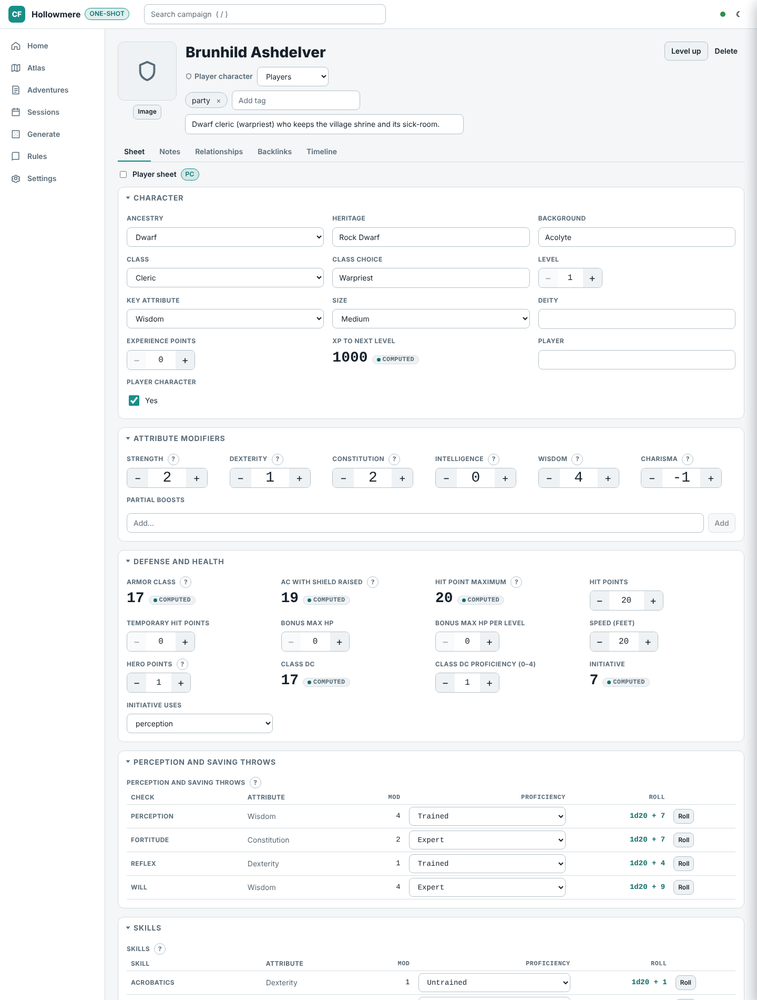
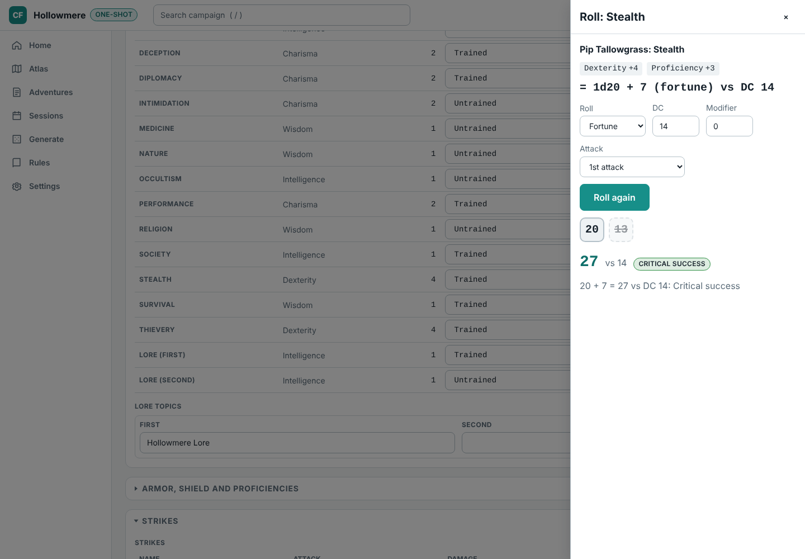
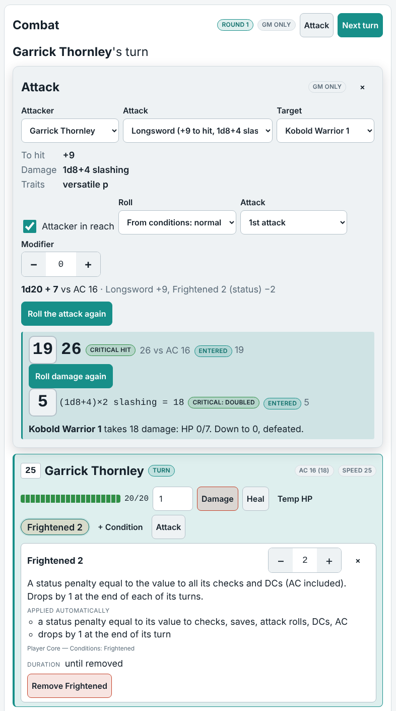
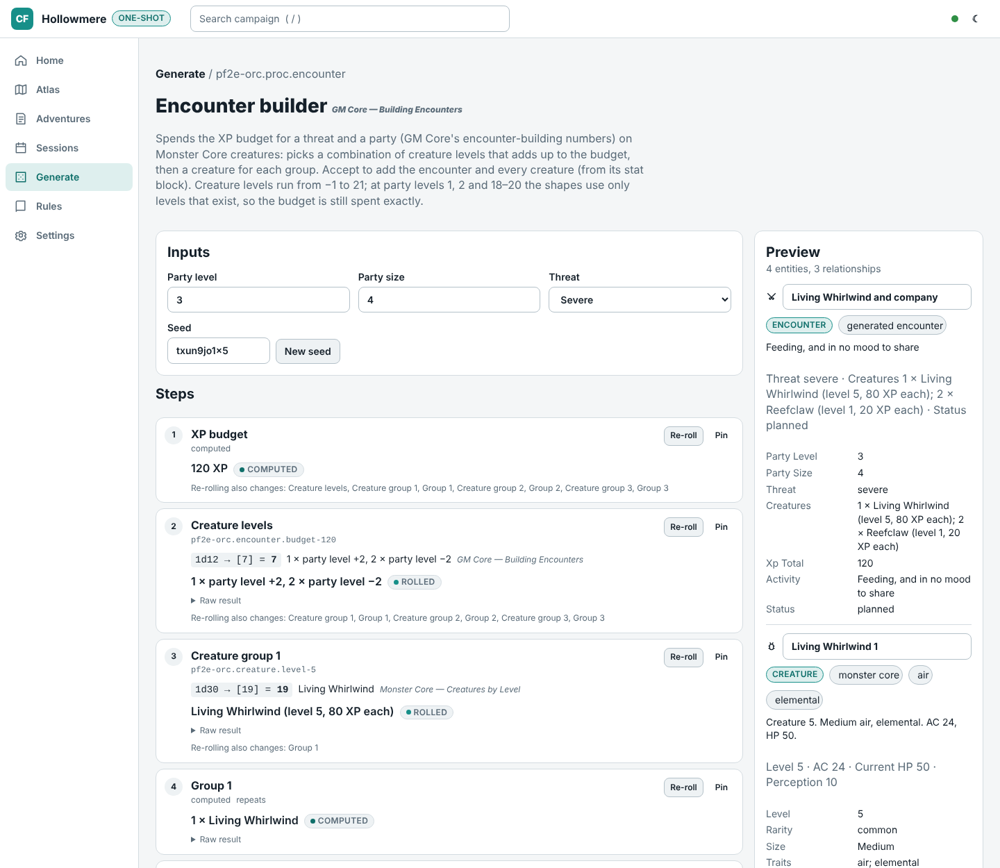
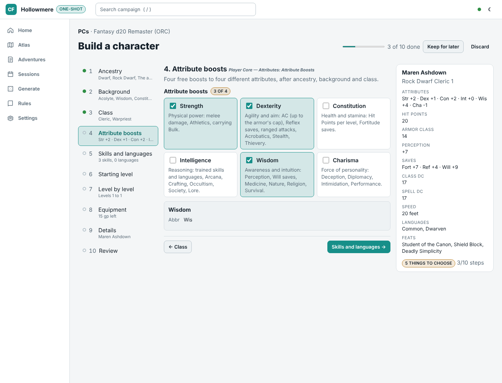
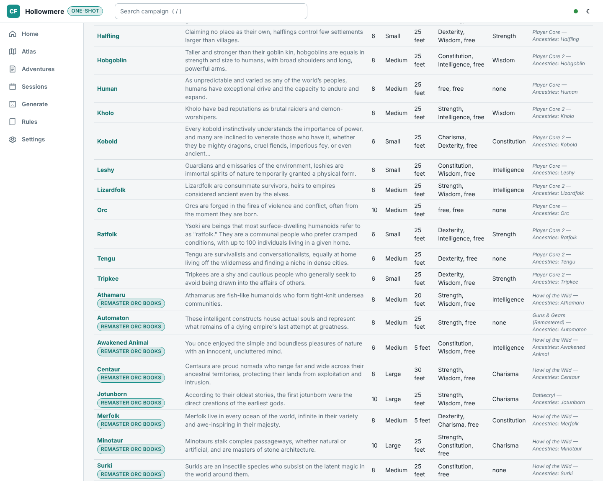

# Fantasy d20 Remaster (ORC)

[Campaign Forge](../../README.md) · [App features](app.md) · [Alien RPG](alien.md) · [Fifth edition](dnd5e.md) · [Remaster (ORC)](orc.md)

The `pf2e-orc` module (`packages/module-pf2e-orc`), a built-in JSON data pack of the ORC-licensed core rules, compatible with Pathfinder Second Edition (Remaster), with an optional built-in supplement for nine more remaster books.

Demo: *Hollowmere*, a one-shot with four level 1 characters, kobold oil thieves and a xulgath den, and a fifth character half-way through the builder.

## What it adds

- **The core books.** The ORC-licensed content of Player Core, Player Core 2, GM Core and Monster Core and none of the setting's names: 490 Monster Core stat blocks and 32 hazards as presets; ancestries, heritages, backgrounds, classes, 1,814 feats, 663 spells and 1,243 items as reference lists; every condition and action as a rule card cited by section.
- **Character sheets.** Perception, saves and skills from proficiency ranks (level + 2/4/6/8), class DC, AC, Hit Points, spell DC and Bulk, all derived.
- **Four degrees of success.** DC ± 10, with natural 20 and 1 shifting one step; fortune, misfortune and the multiple attack penalty in the roll panel.
- **Character builder.** *Build a character* (Atlas PCs tab, or *New*) walks through ancestry (heritage, versatile heritages included; Hit Points, size, speed, senses, languages and traits; the ancestry's boosts and flaws, or the alternative two free boosts), background (one of its two boosts and a free one, trained skill and Lore, skill feat), class (key attribute, initial proficiencies, 1st-level features and the class's choices such as instinct, doctrine, muse or school), four free boosts, trained skills and languages from Intelligence, a starting level from 1 to 20 with every level's ancestry, class, skill and general feats (prerequisites checked where the data allows, otherwise confirmed by the GM; archetype feats in class feat slots on request), skill increases up to the rank the level allows, boosts at 5th, 10th, 15th and 20th (partial boosts above +4) and the class features gained with their proficiency increases, then starting wealth by level with an optional shopping list (armor, shield and Strikes go on the sheet), and details (the deity is free text). The side summary shows the attribute modifiers, Hit Points, AC, Perception, saves, class DC and spell DC as they follow from the picks; the review lists every grant with its source and what is left to do by hand. *Level up* on a sheet adds the next level. The supplement's ancestries and classes work the same way, with their source badge.
- **Encounter builder.** Spends GM Core's XP budgets on Monster Core creatures for the party's level and size.
- **At the table.** Trackers for initiative, Hit Points, dying/wounded/doomed, Hero and Focus Points and valued conditions.
- **Combat.** The table's combat panel rolls Strikes from Monster Core's numbers (every creature's attack modifier, damage dice and types, persistent damage, agile and other traits; the supplement's creatures too) and from a character's Strikes table, with the multiple attack penalty, four degrees against AC (a critical hit doubles the damage) and basic saves (none, half, full or double). Immunities, weaknesses and resistances apply in the rules' order, by damage type, group (physical, all) or material and trait (cold iron, holy), with their exceptions; immunities to conditions are kept apart. At 0 Hit Points a character is dying 1 (2 on a critical hit) plus its wounded value; healed, it loses dying and gains wounded.
- **The 43 conditions with helper text.** Each says what it does (the ORC rules text, shortened, cited by book and section) and what the app applies by itself: status and circumstance penalties on checks, saves, attack rolls, DCs, AC and damage (frightened, sickened, clumsy, enfeebled, drained, stupefied, fatigued, fascinated, off-guard, prone, unconscious), where penalties of one type don't stack and the worst counts; frightened dropping by 1 at the end of each turn; and the conditions each one brings (grabbed: off-guard and immobilized; unconscious: blinded, off-guard and prone). The rest (flat checks, lost actions, attitudes) is listed as not automated.
- **GM screen.** Degrees of success, simple DCs and DCs by level; initiative, the multiple attack penalty, encounter budgets and Hero Points; dying, wounded and doomed, healing and exploration activities; and on the player side basic and skill actions with their action costs, cover and detection, and the common conditions, with the ORC Notice.
- **Remaster ORC books (optional).** A built-in supplement, switched on per device under *Game modules…*, adds the ORC content of nine more remaster books: 820 creatures and NPCs, 27 hazards, 12 classes, 8 ancestries, feats, spells and items, still without the setting's names.
- Not affiliated with Paizo; see the [licence](#licence).

## Screenshots

**Remaster sheet**: a level 1 cleric from *Hollowmere*; attribute modifiers and proficiency ranks are written down, and every check total, AC, Hit Points, class DC and spell DC is computed.

**Four degrees of success**: a Stealth check rolled with fortune against a DC and beaten by 10 or more: a critical success.

**Remaster combat**: Garrick, frightened 2 (−2 status to his checks, DCs and AC, shown on the chip's helper text), strikes a kobold with his longsword: 19 + 9 − 2 = 26 against AC 16 is a critical hit, the damage is doubled and the kobold goes down. The dice were rolled at the table and typed in.

**Encounter builder**: a severe encounter for four level 3 characters, GM Core's XP budget spent on Monster Core creatures by level.

**Character builder**: the demo's half-built dwarf cleric at the attribute boosts: three of four free boosts picked, the stepper with each step's picks, and the side summary with the attribute modifiers, Hit Points, AC, Perception, saves, class DC and spell DC that follow from them.

**Built-in supplement**: *Remaster ORC books* switched on under Game modules; Hollowmere's ancestries list gains eight from Howl of the Wild, Guns & Gears and Battlecry!, each with its source badge and citation.

## Licence

The Fantasy d20 Remaster (ORC) module (`packages/module-pf2e-orc`) includes material from Player Core, Player Core 2, GM Core and Monster Core under the ORC License, and only entries the source marks as ORC-licensed and remastered. Its notices, shown in the app wherever the module's licence appears and in full in its [NOTICE](../../packages/module-pf2e-orc/NOTICE):

> **ORC Notice.** This product is licensed under the ORC License located at the Library of Congress at TX 9-307-067 and available online at various locations. All warranties are disclaimed as set forth therein.
>
> **Attribution Notice.** This product includes material from Pathfinder Player Core © 2023, Paizo Inc.; Pathfinder Player Core 2 © 2024, Paizo Inc.; Pathfinder GM Core © 2023, Paizo Inc.; and Pathfinder Monster Core © 2024, Paizo Inc. (the full designer and author credits are in the module's NOTICE and manifest).

None of the publisher's Reserved Material is used: the converter drops or rewrites the setting's proper nouns (deities, places, planes, organizations, characters) and the tests check none remain. Compatible with Pathfinder Second Edition (Remaster). Not affiliated with or endorsed by Paizo Inc. Pathfinder is a trademark of Paizo Inc. Its JSON structure derives from the Foundry VTT pf2e system (Apache-2.0). The *Hollowmere* demo is original content.

Its built-in supplement *Remaster ORC books* (`packages/module-pf2e-orc/supplements/`, off unless the GM switches it on) includes material from Monster Core 2, NPC Core, Howl of the Wild, Treasure Vault (Remastered), Battlecry!, Impossible Magic, Guns & Gears (Remastered), Dark Archive (Remastered) and War of Immortals under the ORC License, again only entries the source marks as ORC-licensed and remastered (Rage of Elements is marked OGL there, so none of it is used), with the same ORC Notice, each book's Attribution Notice (in its manifest and its [NOTICE](../../packages/module-pf2e-orc/supplements/NOTICE); seven are incomplete in the source and marked TODO for the owner), the same disclaimer, and none of the setting's names (the module's Reserved Material list grew to 433 terms for these books).
