# Your first Alien campaign

[Campaign Forge](../../README.md) · [Alien RPG (Evolved Edition)](../features/alien.md)

<!-- Generated by `pnpm guides` from the alien module's guide (alien.first-campaign); edit the module, not this page. -->

A walkthrough for campaign play, from an empty campaign to the end of session 1: the crew and their ship, places and people, how to connect them, a job run as an adventure, and the session itself. Follow it in your own campaign; the example names are only there to show where things go.

In the app, the same guide is the **Guide** page of every Alien RPG (Evolved Edition) campaign (on Home, and on the setup checklist), where every step links straight to where it is done. Written for Campaign play.

## Contents

1. [Create the campaign](#1-create-the-campaign)
2. [Make the crew](#2-make-the-crew)
3. [The crew's ship](#3-the-crews-ship)
4. [Places](#4-places)
5. [People](#5-people)
6. [Connect them](#6-connect-them)
7. [An adventure](#7-an-adventure)
8. [A session](#8-a-session)

## 1. Create the campaign

One campaign holds everything: the crew, the places, the jobs and every session.

### 1.1 Start a campaign

On the campaign list, click *New campaign*. Give it a name (the example is Breakwater Freight), keep *Alien RPG (Evolved Edition)* as the *Game module* and choose the *Play mode*.

*Campaign* is long-running play with player-made characters, jobs and a home base; this guide follows it. *Cinematic* is a one-shot in three acts with pregenerated characters, built with the guided adventure builder instead.

Campaign play asks the *Campaign frame* once: *Space Truckers*, *Colonial Marines* or *Frontier Colonists*. Job boards and between jobs start from it, and Settings can change it later. Click *Create campaign*.

*Rulebook: p. 234-235.*

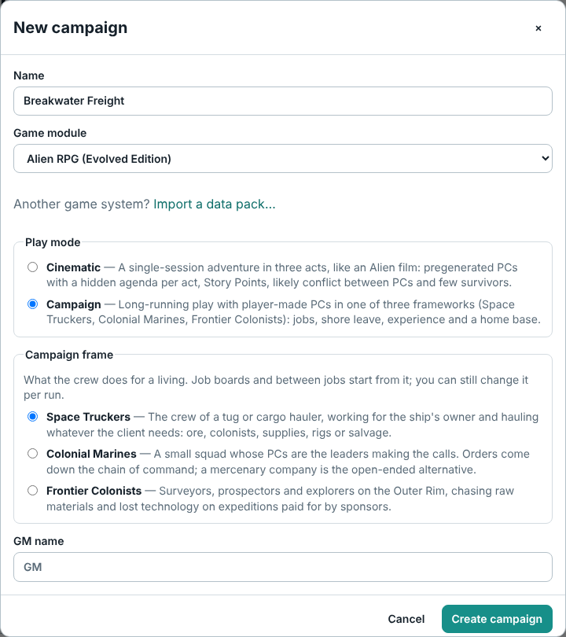

### 1.2 Meet the setup checklist

The campaign opens on *Home*, which leads with *Set up your campaign*: eight steps from the crew to session 1. Each one ticks itself when the campaign holds what it asks for, and its buttons go straight to where it is done. The highlighted step is the next one.

You can do the steps in any order, or click *Hide this*; *Settings* can show the checklist again. This guide walks the same ground with a bit more about each page; *Guide* on Home, or *Step-by-step guide* on the checklist, brings you back to it.

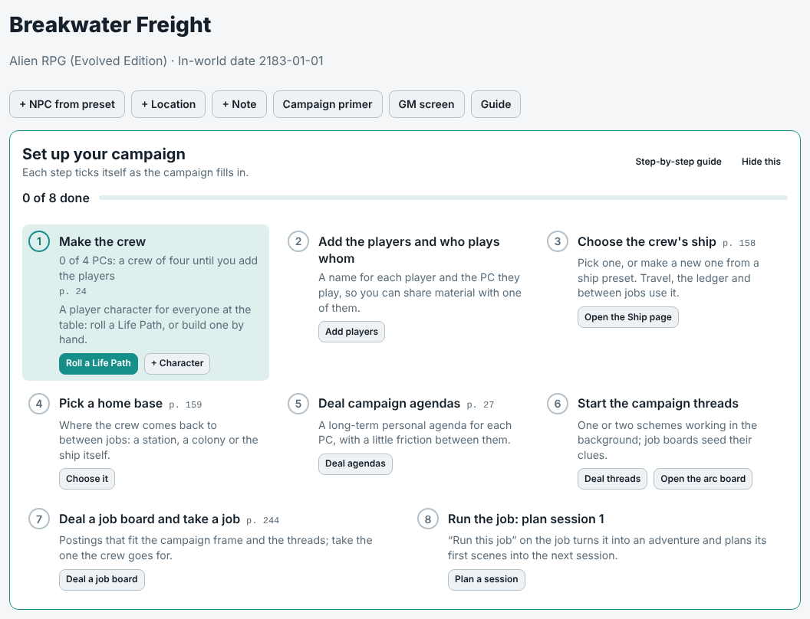

## 2. Make the crew

A player character for each player, and who plays whom.

### 2.1 Roll a character with the Life Path

Click *Roll a Life Path* in the checklist (it is also beside *+ New* on the Atlas's *PCs* tab). Every roll of the appendix's life path is laid out with its page; pick a *Career* or let the dice decide, and *Re-roll* or *Pin* any step you want changed or kept.

The preview reads like the finished sheet: career, talents, gear and the summary line. Type the character's name in it (here Juno Okafor, a pilot) and click *Accept into campaign*: the new PC opens, with every roll kept as provenance.

*Rulebook: p. 282-289.*

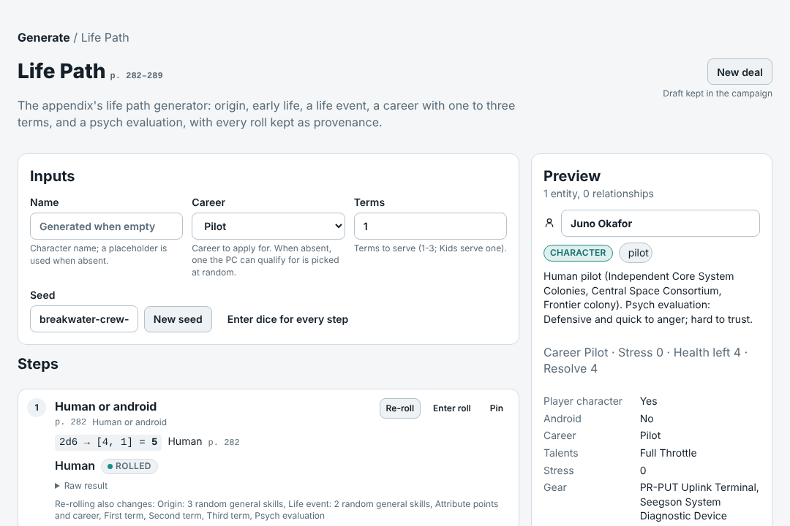

### 2.2 Or make one by hand

Click *+ Character* in the checklist. *Player character* is already ticked under *Starting details*; type a *Name* (here Tobias Reyne), start from *Blank* or one of the typical NPCs as a base, add starting weapons if you like, and click *Create character*.

Fill in the rest on the sheet: attributes, skills, talents, gear. Health and Resolve work themselves out from the attributes.

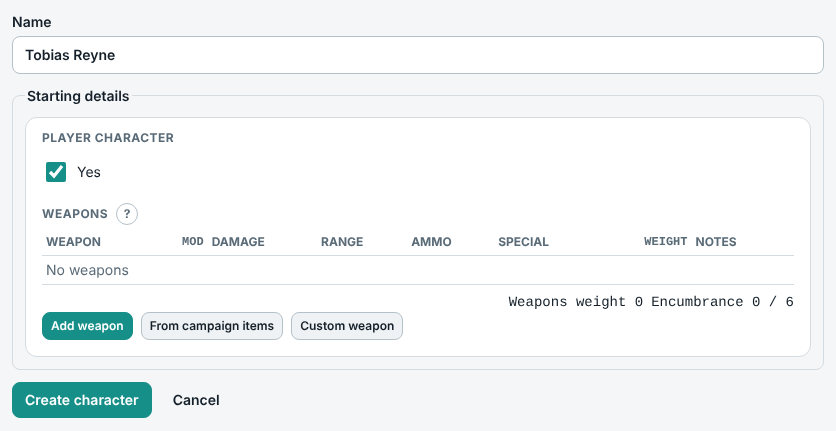

### 2.3 Add the players and who plays whom

Click *Add players* in the checklist: it opens *Settings* at *Players*. Type each player's name and click *Add player*, then tick who plays which PC (*Alex plays Juno Okafor*).

Players have no accounts in this version; knowing who plays whom lets you share a handout with one player and send each player a packet with their own sheet.

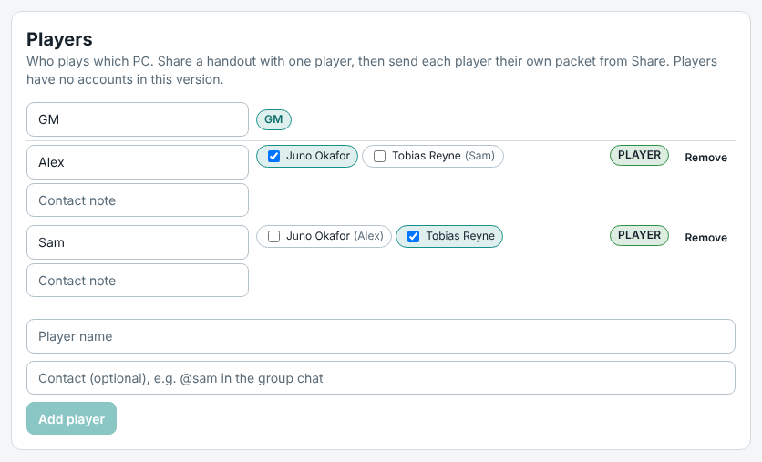

### 2.4 Buddy and rival

Open a PC from the Atlas's *PCs* tab. Its sheet shows who plays it (*Played by*), and the *Buddy and rival* section picks from the other PCs: the first connections in the campaign.

Each is a pair: making Juno Tobias's buddy makes Tobias Juno's buddy too (unless Juno already has one: then the app asks). The session wrap-up's XP questions and the campaign agendas read them, so pick them now if your players have.

*Rulebook: p. 27.*

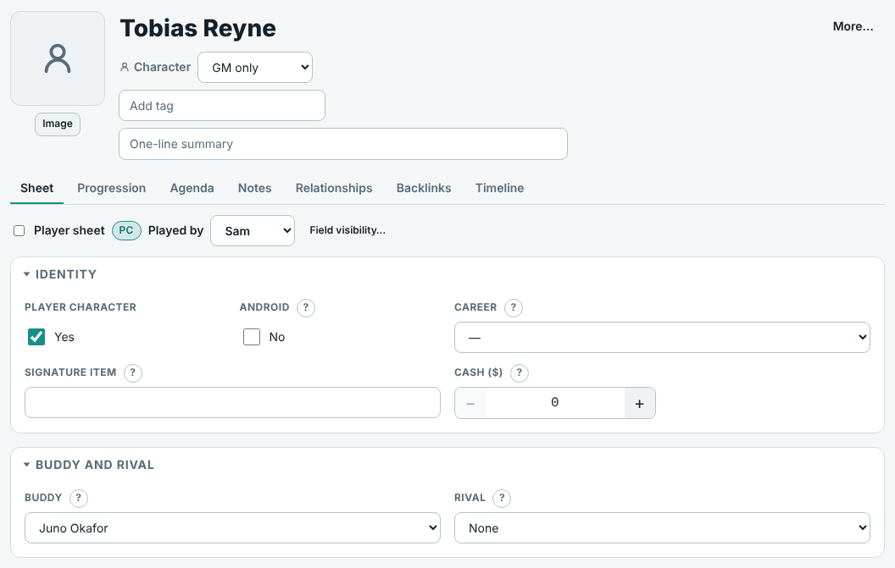

## 3. The crew's ship

### 3.1 Choose the crew's ship

Open *Ship* in the sidebar. Under *Crew's ship*, choose *+ New spaceship…*, start from a ship preset (the example uses the *Model CM-88G Bison*), name it (Marigold Dawn) and click *Create and choose*.

The page then shows the ship's hull, parts and provisions, the ledger of crew funds and each PC's cash, the travel planner and *Run between jobs*. Table mode shows the ship too.

*Rulebook: p. 158.*

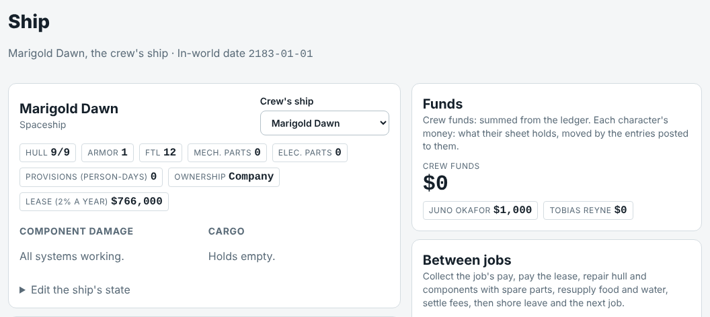

## 4. Places

Locations nest: a system holds a planet, a planet a colony, a station a bar.

### 4.1 Add a station

On Home, click *+ Location*. Choose a *Subtype*: a *Colony* suits a station or settlement, a *Site* a single place such as a bar, a mine or a derelict, and there are *Star system* and *Planet* sheets too. Start from *Blank*, or from one of the book's places in the preset list.

Name it (Halvorsen Relay) and click *Create location*. On its page, write the one-line *Summary* under the name: what the place is, at a glance.

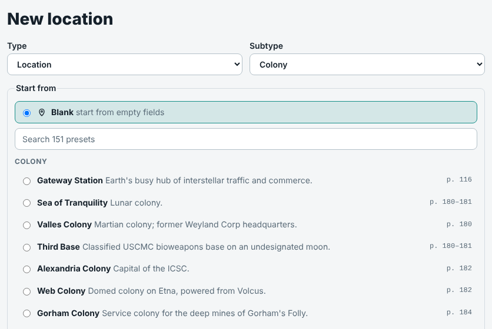

### 4.2 Put a place inside another

Make a second location, a *Site* called The Lantern Bar. On its page, open *Relationships*, click *+ Add relationship*, choose *within*, click *Choose…*, pick *Halvorsen Relay* and click *Add*.

The Atlas's *Locations* tab now shows the bar under the station. The same *within* link nests planets in systems and colonies on planets; the star system and world generators do it for you.

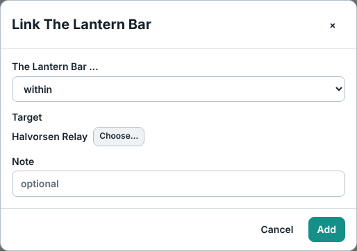

### 4.3 Make it the crew's home base

Click *Choose it* on the checklist's *Pick a home base* step: it opens *Settings* at *Campaign*. Pick *Halvorsen Relay* as the *Home base* (or *+ New location…* to make one there).

Job boards post their jobs at the home base, and between jobs the crew comes back to it.

*Rulebook: p. 159.*

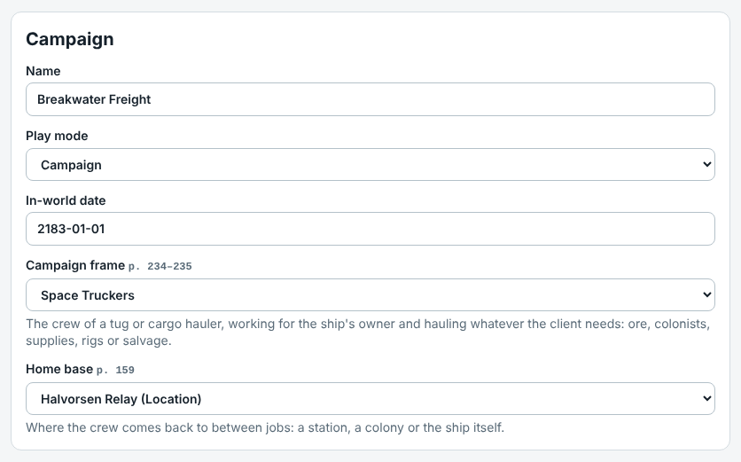

## 5. People

NPCs from the book's typical NPCs, by hand, or from a generator.

### 5.1 An NPC from a preset

On Home, click *+ NPC from preset*. *Search presets* for the kind of person you need, pick one of the book's 25 typical NPCs (here *Ship’s engineer*), give them a name (Oskar Brandt) and click *Create character*. The stat line, skills and weapons come with the preset.

*Rulebook: p. 258-259.*

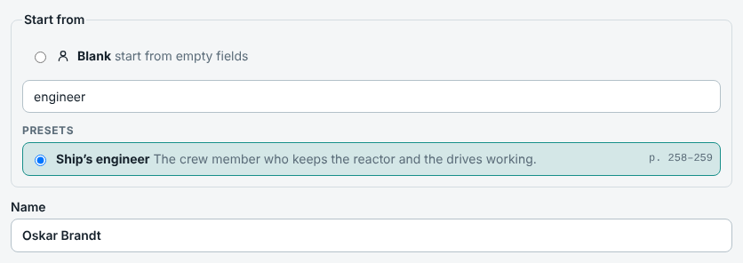

### 5.2 An NPC by hand, and the NPCs tab

On the Atlas's *NPCs* tab, click *+ New*, start from *Blank*, name them (Wen Halloran, the station's harbourmaster) and write the *Summary*: one line on who they are. Add stats only if they will ever roll.

The job board makes NPCs too: every job it deals comes with its contact and the other people in it, each with a want, a secret and an agenda (see *Take the job* below).

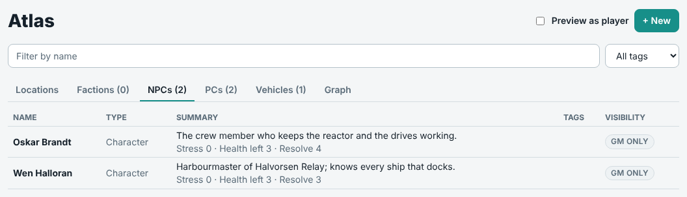

## 6. Connect them

Relationships, links in notes, and who gets to see what.

### 6.1 Add a relationship

Open an NPC (Oskar Brandt), go to *Relationships* and click *+ Add relationship*. Choose how they relate (*knows*, *member of*, *owns*, *wants*, *buddy of*, *rival of*, *crew of*, *within* and more), *Choose…* who, add a *Note* if it helps (“Owes him a favour from the Pell run”) and click *Add*.

A relationship shows on both pages: Tobias Reyne's *Relationships* tab lists Oskar Brandt too.

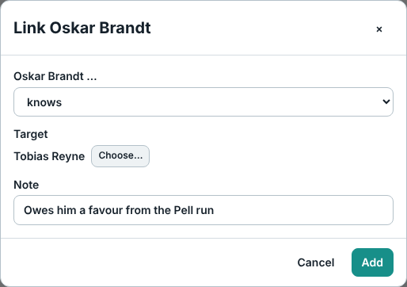

### 6.2 Link people and places in a note

On the same page, open *Notes* and click *+ Add note*. Type *@* and a few letters of a name: pick the entity from the list to link it, or make a new one on the spot with *Create “…” as…*. Scene notes, read-aloud text and the notes on Home's *+ Note* link the same way.

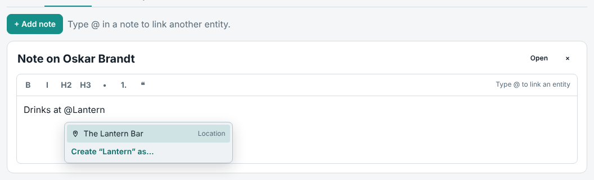

### 6.3 See what links here

Open the place you linked (The Lantern Bar) and its *Backlinks* tab: every note, scene, session and handout that mentions it, with how. Click one to open it.

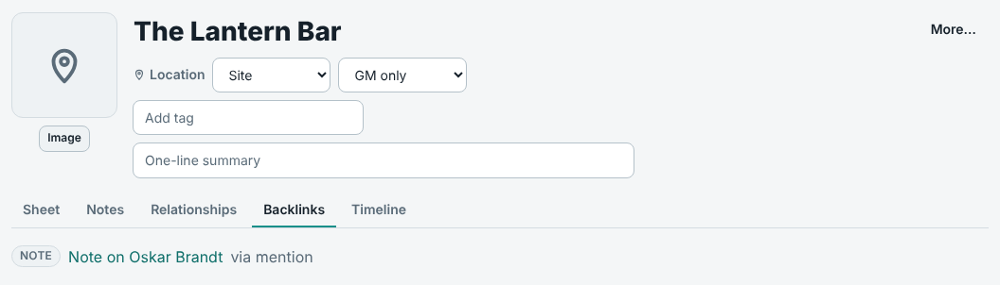

### 6.4 The graph

The Atlas's *Graph* tab draws every relationship at once, places beside people; the filters above it narrow it to a type or a tag.

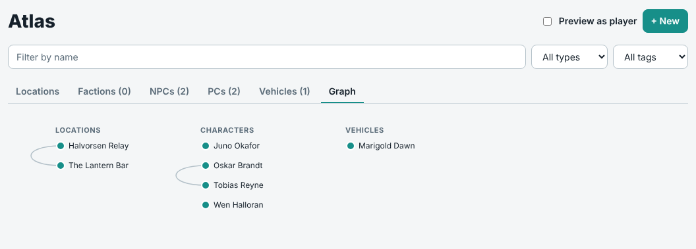

### 6.5 GM only, or for the players

Everything starts *GM only*. The select beside the type on each page sets who may see it: *Players*, *Revealed* once it has come up in play, or *Some players*; *Field visibility…* hides single fields, such as a secret.

Tick *Preview as player* on the Atlas to check: here only Halvorsen Relay, set to *Players*, is left. Sharing with players and table mode's player screen follow the same rules.

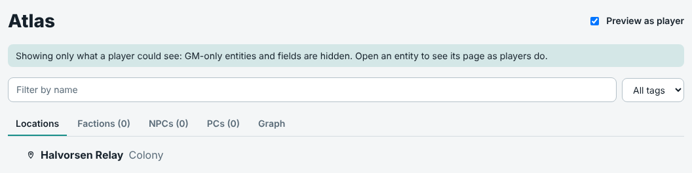

## 7. An adventure

In campaign play an adventure is usually a job: deal a job board, take a posting, run it.

### 7.1 Deal a job board

Click *Deal a job board* in the checklist, or *Job board* on *Generate*. It deals postings for the campaign frame, each as the players read it (pay, who posted it, requirements, a risk rating that may mislead) beside what only the GM knows (complications, the twist, the employer's real intent, and up to three NPCs with their agendas).

Change *Postings*, *Employer bias* or *NPC treachery* and the board deals again; a *Seed* gives the same board every time. *Parts to re-roll or pin* re-rolls one part of a posting.

*Rulebook: p. 244-252.*

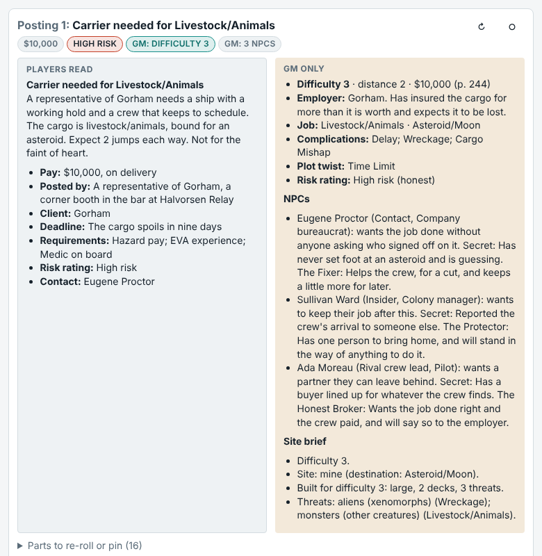

### 7.2 Take the job

Click *Take the job* on the posting the crew goes for. The job, its employer, its NPCs (the contact visible to the players, the others GM-only until met) and a players' posting handout join the campaign, and Home's *Job board* lists the job under *Accepted*.

The other postings stay on the board as dealt: *Keep as lead* keeps one for later, *Discard* drops it.

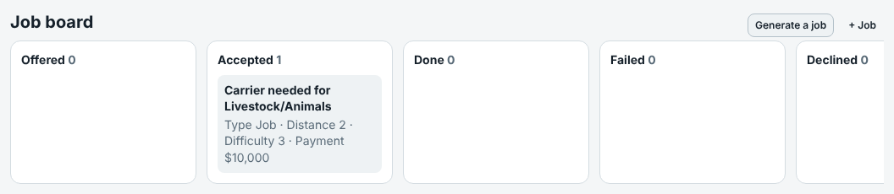

### 7.3 The job's people

Open the job (rename it if you like: here The Brannock Deep run). *People in this job* lists its NPCs with what they want, their secret, their agenda and whether they turn on the crew. They are ordinary NPCs: link them, note them and put them in scenes like anyone else.

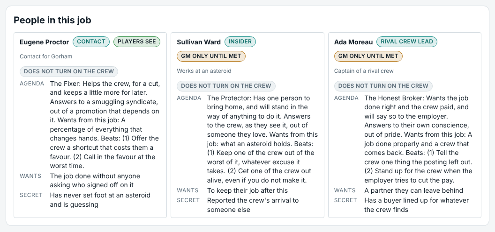

### 7.4 Generate the site map

On the job page, click *Generate site map*. The generator reads the job's site brief (site type, size, decks, threats, key rooms, the job's NPCs); type a *Seed* or keep the one offered, click *Generate*, look the map over and click *Save to campaign*. It is saved with the job's site, and the arrival scene will use it.

*Rulebook: p. 54-58.*

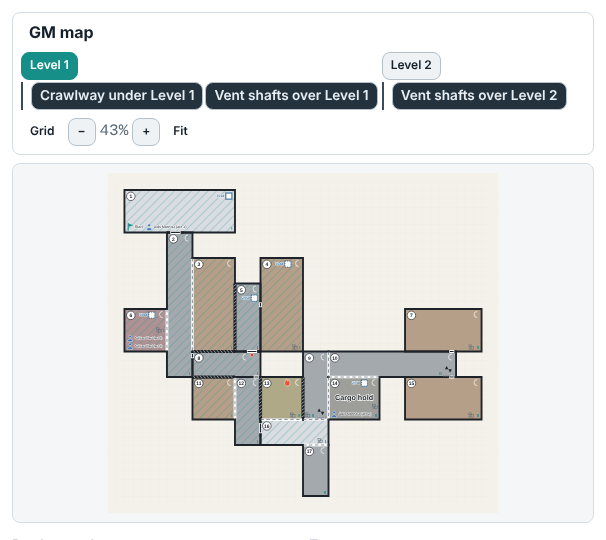

### 7.5 Run this job

Click *Run this job* on the job page. It becomes an adventure in four acts (briefing and departure, travel, destination, payout) with its scenes: the posting is the players' introduction, the complications, twist and NPC secrets are the GM's situation, and the arrival is set at the job's site on its site map.

The briefing, transit, arrival and first complication are planned into the next session, so session 1 now exists.

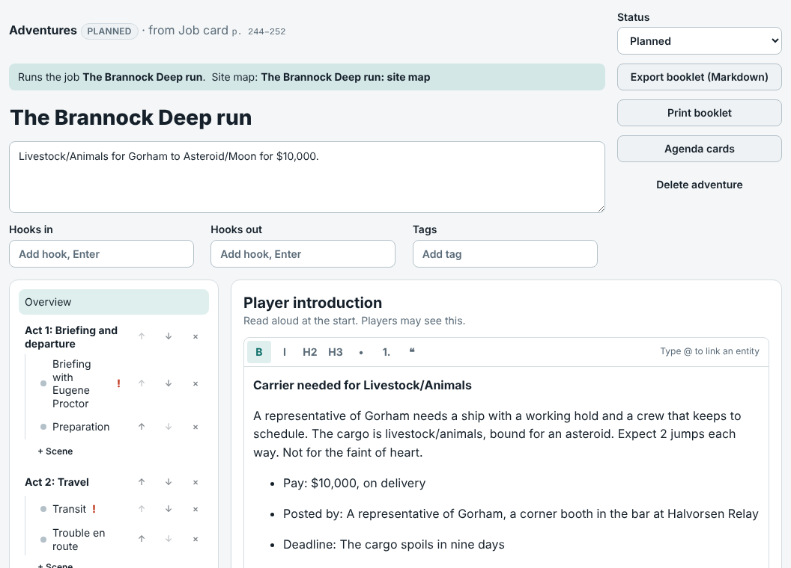

### 7.6 Put places and people in a scene

Click a scene in the outline. *Location* *Pick* sets where it happens (here the briefing moves to Halvorsen Relay); *Participants* *+ Add* puts NPCs, PCs, creatures and vehicles in it (Oskar Brandt joins the contact). *Clues*, *Encounter* and *Map* (an existing map, or *Create map* from an image) work the same way.

Below, *Events* lists what must or may happen, *Read-aloud text* is the boxed text for the players, and *Scene notes* take *@* links. Table mode shows all of it for the scene you are in.

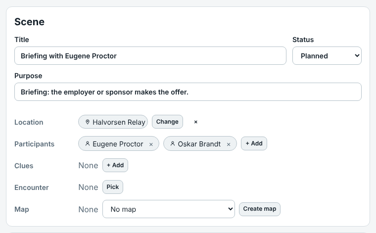

### 7.7 Add a handout

Click an act in the outline (Act 1) and, under *Handouts*, *+ Handout*. Title it (here “Berth pass, Halvorsen Relay”), open it to write the text or add an image, and leave it *GM only*: you reveal it at the table. *+ Agenda* adds a character's agenda card, which goes to that player alone.

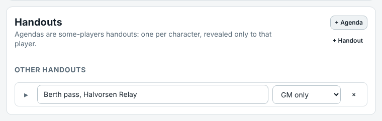

### 7.8 Or start an adventure from a template

*Adventures* → *New adventure* starts one without a job board: the *Job card* (choose a job under *Fill it from a job*, the same as *Run this job*), the module's other templates, or *Blank*. *Show templates for other play modes* lists the cinematic ones too.

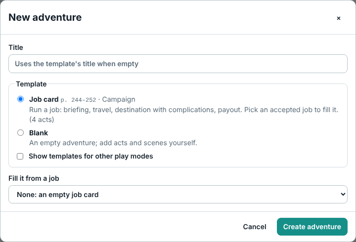

## 8. A session

Plan it, run it at the table, wrap it up; the next one is planned for you.

### 8.1 Plan the session

Open *Sessions* and the planned *Session 1* (or click *Plan next session*). *Scenes planned* is what table mode steps through, in order: reorder them, remove one, or *Add scenes* from any adventure. Under *Plan*, add what to remember (“Oskar wants his favour back”); the *Session checklist* is there if you want it.

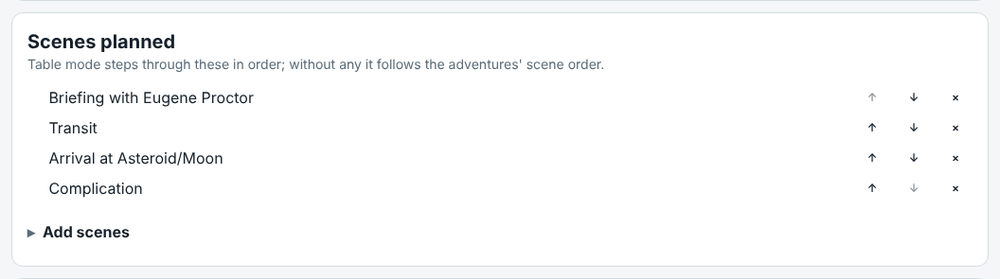

### 8.2 Start it: table mode

Click *Start this session* on Home (or *Start* on Sessions). Table mode shows the scene you are in with its location, read-aloud text, events and participants; *Mark run* or *Skip* it and *Next →* moves on. The clock's *+ Round*, *+ Stretch* and *+ Shift* keep time, and the tabs hold the trackers, dice, hints, the checklist and the log.

*Player screen* opens a second window for the players to look at.

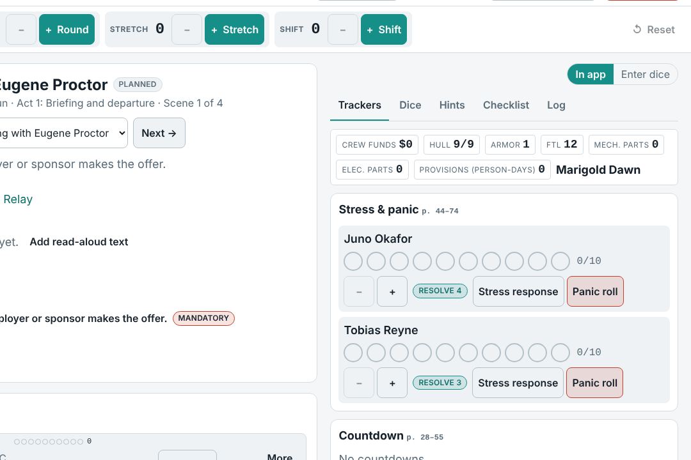

### 8.3 Reveal a handout

In the *Reveal* panel, click *Reveal* beside a handout of the scene, act or adventure: it goes on the player screen and counts as revealed from now on. *Pin* keeps it there, *Clear the screen* takes everything down.

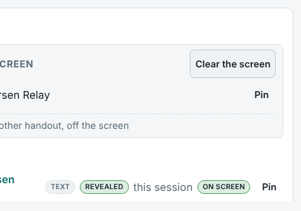

### 8.4 Wrap up

Click *End session*. The wrap-up walks *Summary*, *End-of-session questions* (the XP questions and the award checklist), *Rewards*, *Timeline*, *Loose ends* and *Close the job* (done, failed or carried over, with *Collect payment*); everything you type is kept as you go. Click *Finish session*.

*Rulebook: p. 30.*

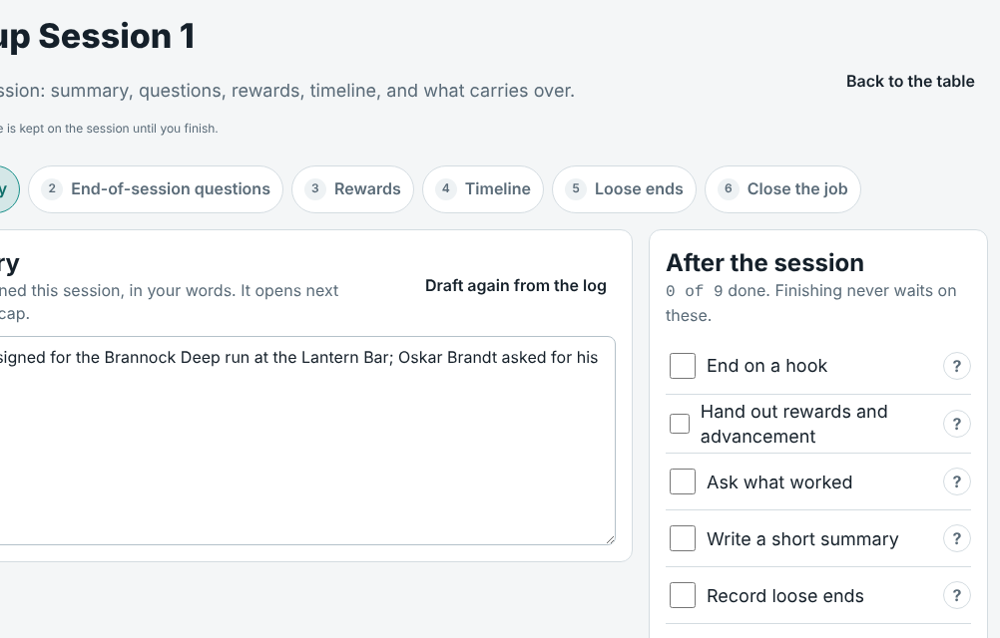

### 8.5 The next session

Finishing plans the next session and carries the loose ends into its *Plan*; it opens on that session's page, ready for its *Scenes planned*. When the job is closed, finishing lands on *Between jobs* instead: pay, upkeep and shore leave, then *Deal the next job board*, and the loop starts again.

Before you start it, *Build the recap* writes a "Previously on…" from what the campaign recorded. The checklist's two remaining steps, campaign agendas and campaign threads, can come in at any point.

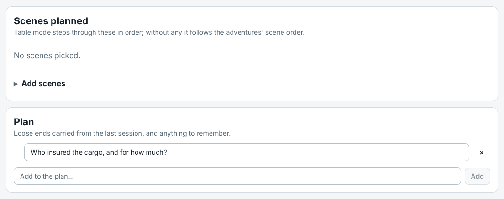
