# Your first 5e campaign

[Campaign Forge](../../README.md) · [5th Edition SRD 5.1 & 5.2 (fantasy d20)](../features/dnd5e.md)

<!-- Generated by `pnpm guides` from the dnd5e-srd module's guide (dnd5e-srd.first-campaign); edit the module, not this page. -->

A walkthrough for campaign play, from an empty campaign to the end of session 1: the party, a town and the people in it, how to connect them, a quest run as an adventure with an encounter and a dungeon, and the session itself with initiative at the table. Follow it in your own campaign; the example names are only there to show where things go.

In the app, the same guide is the **Guide** page of every 5th Edition SRD 5.1 & 5.2 (fantasy d20) campaign (on Home, and on the setup checklist), where every step links straight to where it is done. Written for Campaign play.

## Contents

1. [Create the campaign](#1-create-the-campaign)
2. [Make the party](#2-make-the-party)
3. [Places](#3-places)
4. [People](#4-people)
5. [Connect them](#5-connect-them)
6. [An adventure](#6-an-adventure)
7. [A session](#7-a-session)

## 1. Create the campaign

One campaign holds everything: the party, the places, the quests and every session.

### 1.1 Start a campaign

On the campaign list, click *New campaign*. Give it a name (the example is The Wilby Watch), choose *5th Edition SRD 5.1 & 5.2 (fantasy d20)* as the *Game module* and pick the *Play mode*. The dialog shows the module's licence: the SRD 5.1 and 5.2 are open content under CC-BY-4.0, and their attribution travels with the module.

*Campaign* is long-running play: characters level up over many sessions, with quests and a world that moves between adventures; this guide follows it. *One-shot* is a single evening in three acts. Click *Create campaign*.

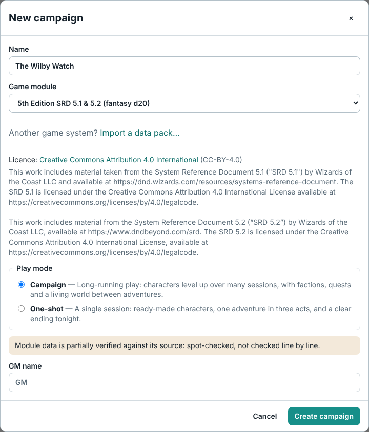

### 1.2 Meet the setup checklist

The campaign opens on *Home*, which leads with *Set up your campaign*: the player characters, the players and who plays whom, and the first session. Each step ticks itself when the campaign holds what it asks for, and its button goes straight to where it is done. You can do them in any order, or click *Hide this*; *Settings* can show the checklist again.

Above it, *+ NPC from preset*, *+ Location* and *+ Note* make things in one click, *Campaign primer* is the players' introduction for session zero, and *GM screen* is the module's quick reference. Further down, the *Quest board* collects the campaign's quests. *Guide* (or *Step-by-step guide* on the checklist) brings you back here.

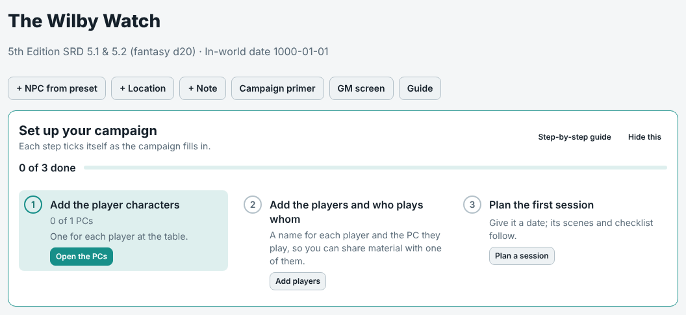

## 2. Make the party

A player character for each player, and who plays whom.

### 2.1 Build a character step by step

Click *Open the PCs* in the checklist, then *Build a character*. The builder walks *Edition* (SRD 5.1 rules, SRD 5.2 rules or *Mixed*), *Species / race*, *Class*, *Background*, *Ability scores* (standard array, point buy, rolled or typed), *Starting level*, spells for a caster, *Equipment*, *Details* and *Review*. Each option shows its full text, and the summary on the right keeps the scores, hit points, AC, saves and skills up to date as you pick.

The example is a hill dwarf fighter with the Acolyte background and a point buy, named Doran Kettleby under *Details*. *Keep for later* saves a half-built character in the campaign; on *Review*, every grant is listed with where it came from, and *Create character* makes the PC.

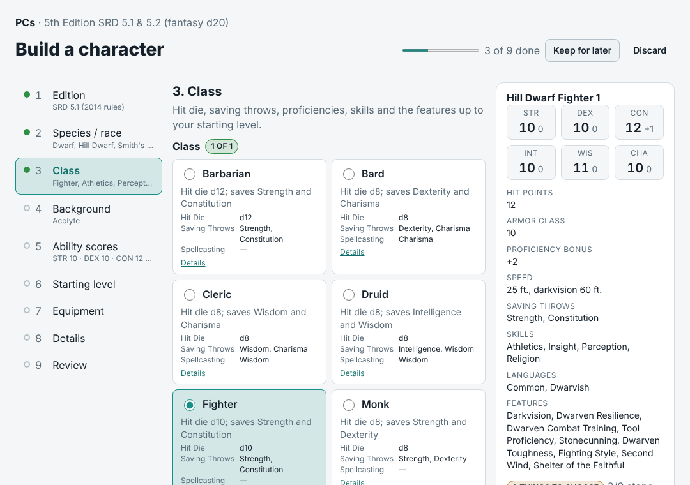

### 2.2 The sheet does the arithmetic

The new PC opens on its sheet. You keep the scores, proficiencies, level and gear; everything marked *Computed* is worked out from them each time the sheet is shown: ability modifiers, proficiency bonus, initiative, saving throw and skill bonuses, passive Perception, hit dice and the spellcasting numbers.

*Roll* beside a save or skill rolls the d20 with its bonus, with advantage, disadvantage and a DC if you want them. *Level up* adds a class level later, multiclassing included.

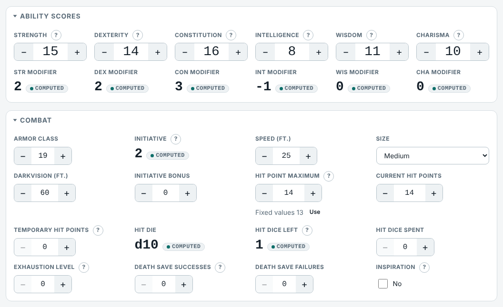

### 2.3 Or make one by hand

On the Atlas's *PCs* tab, click *+ New*. The *New player character* page offers the builder again (*Build step by step*); to skip it, start from *Blank*, type a *Name* (here Mira Fenwick) and click *Create player character*, then fill in the sheet yourself. The computed numbers follow whatever you type.

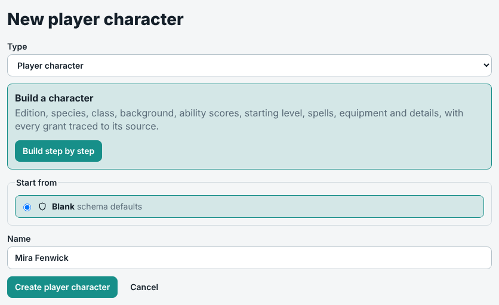

### 2.4 Add the players and who plays whom

Click *Add players* in the checklist: it opens *Settings* at *Players*. Type each player's name and click *Add player*, then tick who plays which PC (*Alex plays Doran Kettleby*).

Players have no accounts in this version; knowing who plays whom lets you share a handout with one player and send each player a packet with their own sheet.

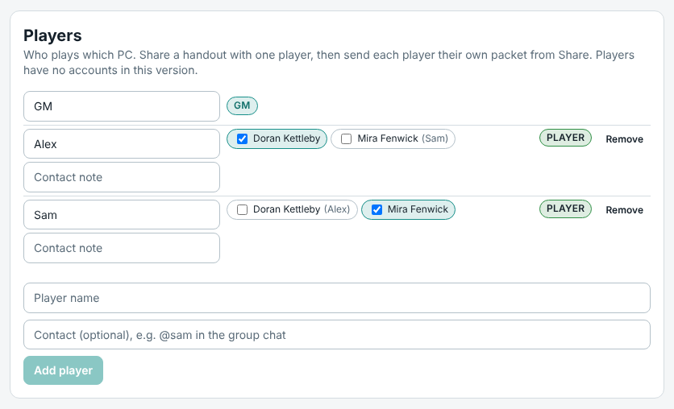

## 3. Places

Locations nest: a town holds its tavern, a dungeon its rooms.

### 3.1 Generate a town and its tavern

Open *Generate* and *Settlement and tavern*. It rolls a name, a size, a notable feature and a local trouble, then the tavern, its house speciality and the innkeeper. Every step shows its roll: *Re-roll* or *Pin* one, *Enter roll* to use your own dice, and a *Seed* gives the same result every time. The *Preview* shows what joins the campaign; the names are editable there.

Click *Accept into campaign*. The example gives the town of Wilby, The Lucky Lantern inside it, Quilla Greyhame the innkeeper, and the trouble (graves are found opened) as a quest rumour Quilla has heard.

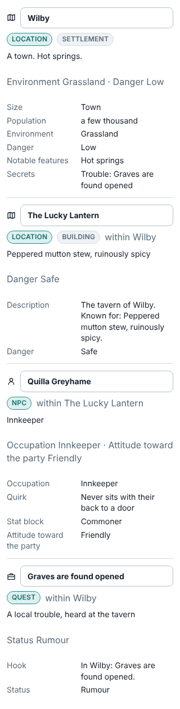

### 3.2 Put a place inside another

On Home, click *+ Location*, choose a *Subtype* (*Settlement*, *Dungeon or lair*, *Room or area*, *Wilderness*, *Building* or *Plane*), name it (here Barrowfield Chapel, a *Building*) and click *Create location*. On its page, write the one-line *Summary* under the name.

Then open *Relationships*, click *+ Add relationship*, choose *within*, click *Choose…*, pick *Wilby* and click *Add*. The Atlas's *Locations* tab now shows the chapel under the town, beside the tavern the generator put there.

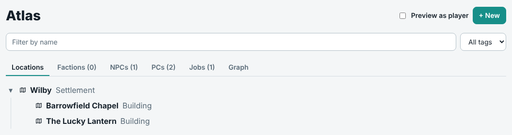

## 4. People

NPCs from the SRD's stat blocks, by hand, or from a generator.

### 4.1 An NPC from an SRD stat block

On Home, click *+ NPC from preset*. It opens a new *Monster* with all 334 SRD stat blocks to start from; the SRD's own people (Guard, Noble, Priest, Veteran and the rest) are among them. Type in the search box, pick one (here *Veteran*), name them (Captain Hollis Varrow, who runs the town watch) and click *Create monster*.

The stat block's numbers, attacks and senses come with it, so the captain is ready if it comes to a fight. Monsters are listed on the Atlas's *Creatures* tab.

*Rulebook: SRD 5.1 — Monsters: Veteran.*

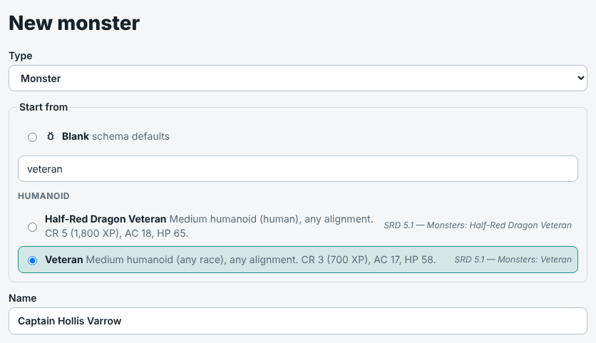

### 4.2 An NPC by hand

For someone who will mostly talk, use the *NPC* sheet. On the Atlas's *NPCs* tab, click *+ New* and choose *NPC* as the *Type*, name them (Brother Tobin Marsh) and click *Create NPC*. Write the *Summary*, then *Occupation*, *Attitude toward the party* and, under *Playing them*, a quirk, a voice, *What they want* and a *Secret*. *Stat block* names the SRD stat block to use if it does come to a fight (Acolyte, for the sexton).

*Generate* → *NPC* rolls one for you: a name, an occupation with a stat block, a quirk, a voice, a want and a secret.

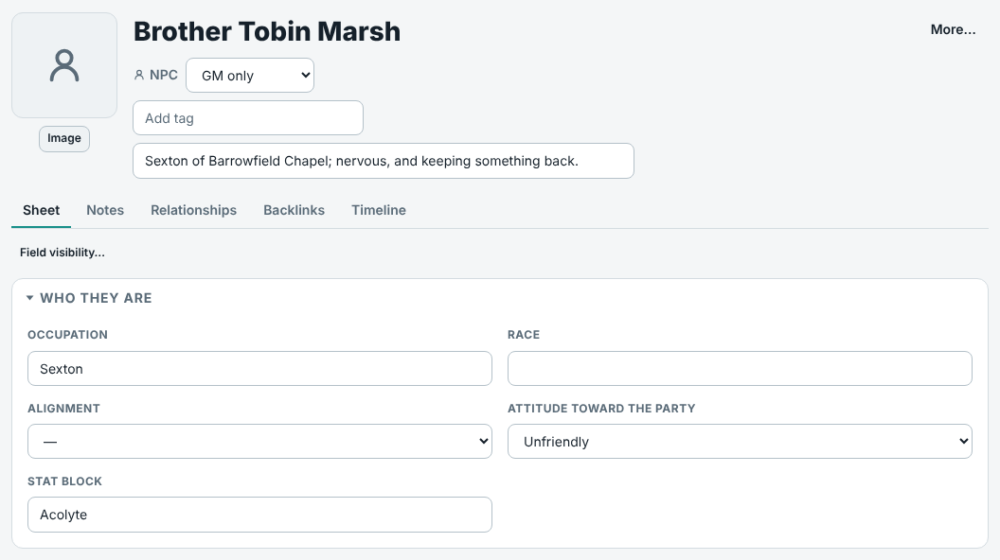

## 5. Connect them

Relationships, links in notes, and who gets to see what.

### 5.1 Add a relationship

On Brother Tobin's page, go to *Relationships* and click *+ Add relationship*. Choose how they relate (*knows*, *member of*, *serves*, *rival of*, *owns*, *wants*, *within* and more), *Choose…* who, add a *Note* if it helps (“Asked him to keep the watch away from the graveyard”) and click *Add*.

A relationship shows on both pages: Captain Hollis Varrow's *Relationships* tab lists the sexton too.

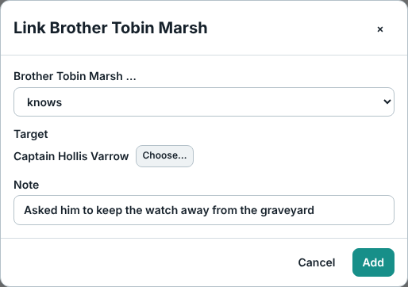

### 5.2 Link people and places in a note

On the same page, open *Notes* and click *+ Add note*. Type *@* and a few letters of a name: pick the entity from the list to link it, or make a new one on the spot. Scene notes, read-aloud text and the notes on Home's *+ Note* link the same way.

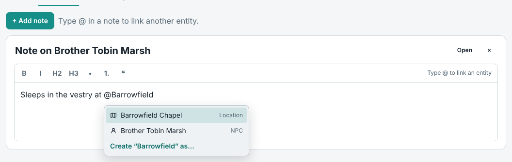

### 5.3 See what links here

Open the place you linked (Barrowfield Chapel) and its *Backlinks* tab: every note, scene, session and handout that mentions it, with how. Click one to open it.

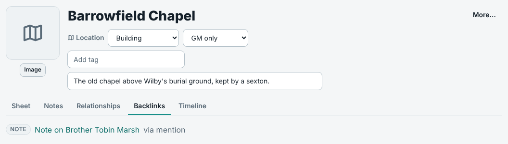

### 5.4 The graph

The Atlas's *Graph* tab draws every relationship at once: the places, the characters, the monsters and the quest, each in its column. The filters above it narrow it to a type or a tag.

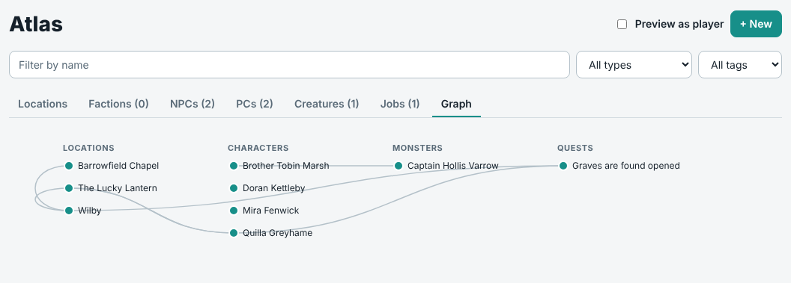

### 5.5 GM only, or for the players

Everything starts *GM only*. The select beside the type on each page sets who may see it: *Players*, *Revealed* once it has come up in play, or *Some players*; *Field visibility…* hides single fields, such as a location's *Secrets* or an NPC's *Secret*.

Tick *Preview as player* on the Atlas to check: here only Wilby, set to *Players*, is left. Sharing with players and table mode's player screen follow the same rules.

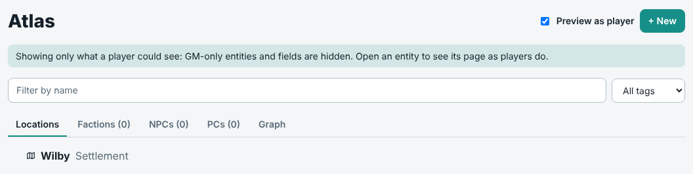

## 6. An adventure

A quest gives the party a reason; an adventure holds what you run: acts, scenes, an encounter on the way and a dungeon at the end.

### 6.1 Take a quest from the quest board

Home's *Quest board* groups the campaign's quests by status. The rumour from the settlement generator sits under *Rumour*; *Generate a quest* opens *Generate*, and *+ Quest* writes one by hand.

Open the rumour and fill in its sheet: *Patron* (Captain Hollis Varrow), *Objective*, *Reward* and *Deadline*, with *Complications* kept GM only. Set *Status* to *Offered* when the party hears it and *Active* when they take it; the board moves it along. *People in this job* lists who is tied to it (Quilla, who heard the rumour).

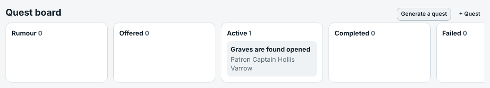

### 6.2 Start an adventure from a template

Open *Adventures* and click *New adventure*. Type a *Title* (The Opened Graves) and choose a *Template*: *Into the lair* is a three-act adventure in which rumours lead to a lair, the lair pushes back, and the aftermath sets up the next session; *Blank* starts empty. *Show templates for other play modes* adds the one-shot template. Click *Create adventure*.

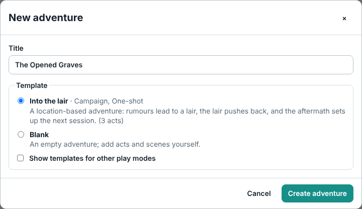

### 6.3 The adventure's acts and scenes

The adventure opens on its *Overview*: the premise, *Player introduction* (read aloud at the start), *The situation (GM only)*, *Acts* and *Epilogue*. The outline on the left holds the template's acts and scenes (Rumours, The lair, Aftermath); a red mark is a scene the template calls mandatory. *+ Scene* and *+ Act* add more, the arrows reorder them, and *Print booklet* or *Export booklet (Markdown)* gives you the whole adventure on paper.

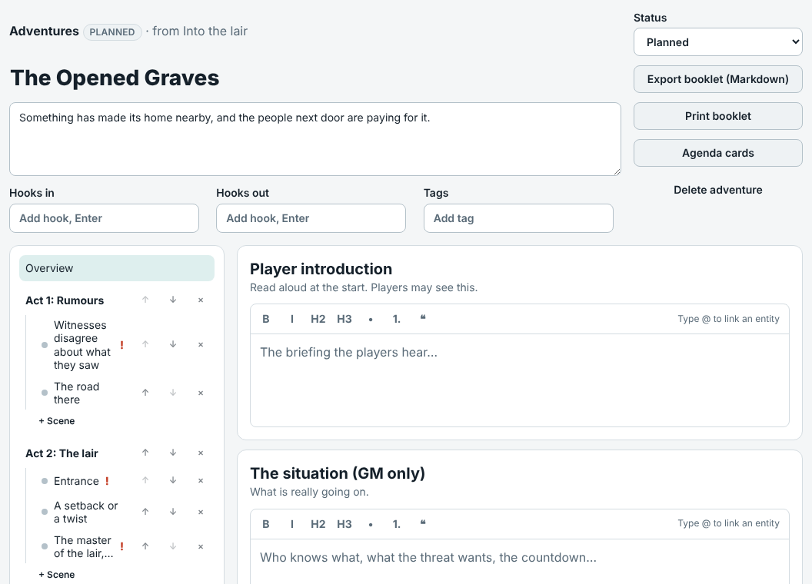

### 6.4 Roll an encounter for the road

The template's second scene is the road to the lair. Open *Generate* and *Random encounter*, set the *Party level* and the *Terrain* (Wilby sits in grassland), and it picks SRD monsters for the terrain and the party's level band, how many, and what they are doing; tick *Include* on *Twist* for a complication.

Click *Accept into campaign*: the encounter and each creature, from its SRD stat block, join the campaign. The example is three bandits arguing about which way to go.

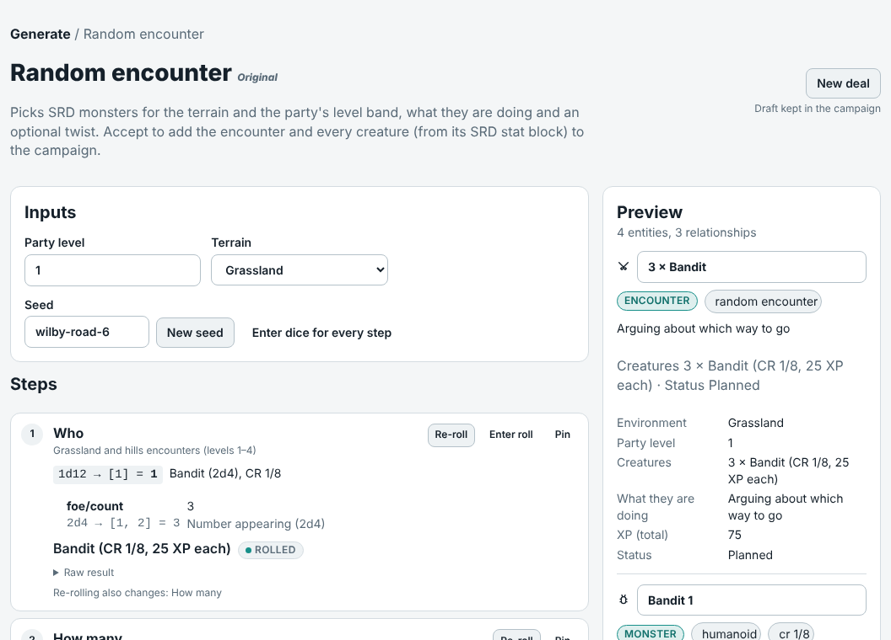

### 6.5 Generate the lair: a dungeon

On *Generate*, under *Site maps*, click *Generate a site map: Dungeon*. Fill the *Brief*: *Site type* (*Crypt or tomb*), *Size*, *Levels*, *Party level* and *Party size*, *Threat* and *Theme* (*The dead*). Type a *Seed* or keep the one offered and click *Generate*: the GM map shows numbered rooms, doors and secret doors, and the marks for encounters, traps and treasure. *Re-run this stage* changes one stage and keeps the rest; *Checks* says every room can be reached.

Name it (The Barrowfield Crypt) and click *Save to campaign*: the dungeon, its rooms, encounters and monsters are added (GM only), and the map page has the room key and a *Player map* that shows only what you reveal.

*Rulebook: SRD 5.1 — Adventuring: Traps, Sample Traps.*

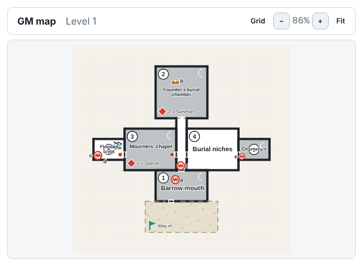

### 6.6 Put places and people in a scene

Back in the adventure, click a scene in the outline. *Location* *Pick* sets where it happens (the witnesses meet at The Lucky Lantern); *Participants* *+ Add* puts NPCs, PCs and monsters in it (Quilla Greyhame and Brother Tobin Marsh). *Encounter* *Pick* takes the bandits' encounter for the road, with the bandits as its participants, and *Map* shows The Barrowfield Crypt on the lair's entrance.

Below, *Events* lists what must or may happen, *Read-aloud text* is the boxed text for the players, and *Scene notes* take *@* links. Table mode shows all of it for the scene you are in.

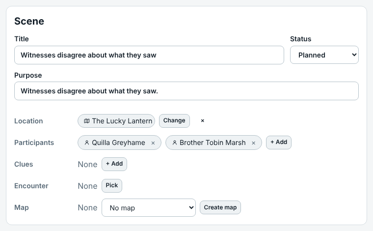

### 6.7 Add a handout

Click an act in the outline (Act 1) and, under *Handouts*, *+ Handout*. Title it (here “A page torn from the burial register”), open it to write the text or add an image, and leave it *GM only*: you reveal it at the table. *+ Agenda* adds a handout for one character, which goes to that player alone.

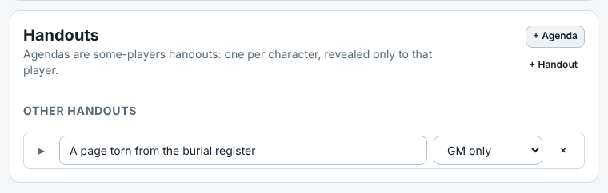

## 7. A session

Plan it, run it at the table, wrap it up; the next one is planned for you.

### 7.1 Plan the session

Click *Plan a session* in the checklist (or *Plan next session* on *Sessions*). Under *Scenes planned*, open *Add scenes* and click *+ Plan* on each scene for tonight, or *Add all* for an act; table mode steps through them in order, and the arrows reorder them. Add what to remember to the *Plan* (“Tobin lies about the crypt key”); the *Session checklist* has the module's own prep items, such as checking hit points and spell slots.

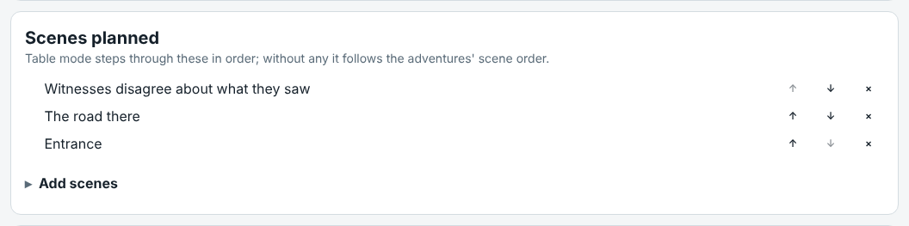

### 7.2 Start it: table mode

Click *Start this session* on Home. Table mode shows the scene you are in with its location, read-aloud text, events and participants; *Mark run* or *Skip* it and *Next →* moves on. *Time* keeps the clock with *+ Round*, *+ Minute* and *+ Hour*, and the tabs hold the *Trackers* (death saving throws, exhaustion, spell slots, hit dice and inspiration for each PC), *Dice*, *Hints*, the *Checklist* and the *Log*.

*In app* or *Enter dice* decides who rolls: the app, or your dice at the table, typed in. *Player screen* opens a second window for the players to look at.

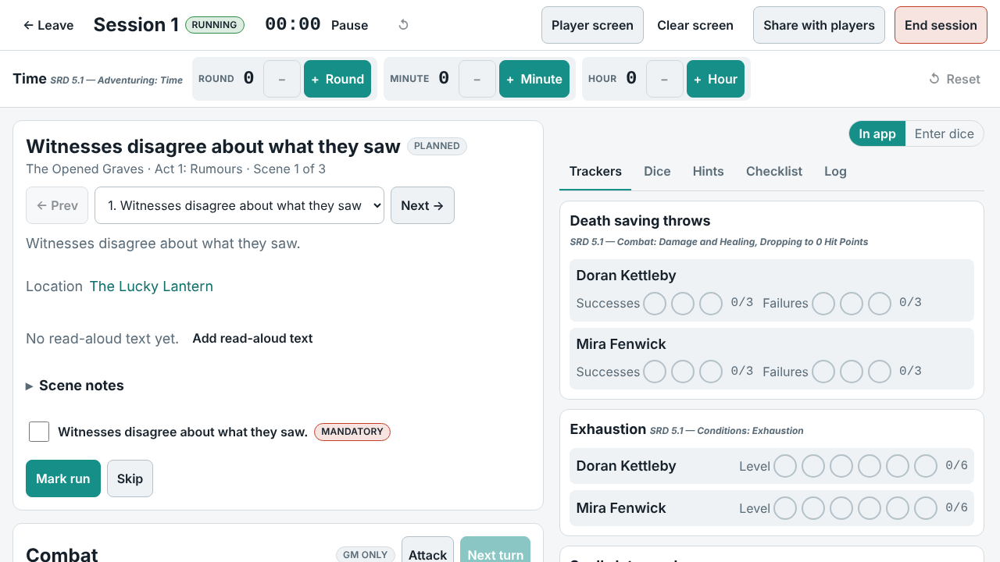

### 7.3 Roll initiative

On the road, the *Combat* panel lists the PCs and the scene's monsters. Click *Roll initiative for everyone*: each rolls a d20 plus its initiative and the order is sorted, highest first, with whose turn it is on top. *Next turn* moves on and counts the rounds.

Each card has its hit points with *Damage*, *Heal* and *Temp HP*, its AC and *+ Condition*. *Attack* rolls an attack from a stat block or the sheet's attacks against a target's AC, then its damage, with resistances, critical hits and saves applied; a condition's chip says what it does and what the app applies by itself.

*Rulebook: SRD 5.1 — Combat: The Order of Combat, Initiative.*

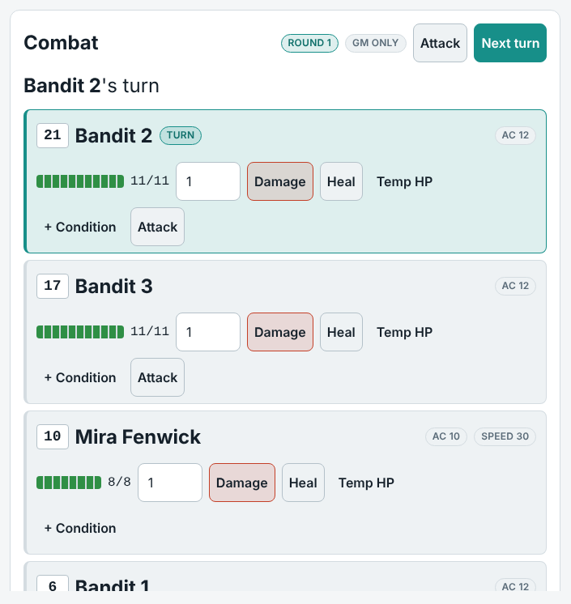

### 7.4 Reveal a handout

In the *Reveal* panel, click *Reveal* beside a handout of the scene, act or adventure: it goes on the player screen and counts as revealed from now on. *Pin* keeps it there, *Clear the screen* takes everything down, and *Hide again* makes it GM only once more.

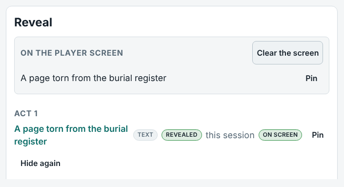

### 7.5 Wrap up

Click *End session*. The wrap-up walks *Summary*, *Rewards* (per character: coin, gear, favours), *Timeline* and *Loose ends*, with the session checklist's after-the-session items beside it (experience or a milestone, treasure and who carries it); everything you type is kept as you go. *Draft again from the log* writes a summary from what the session recorded. Click *Finish session*.

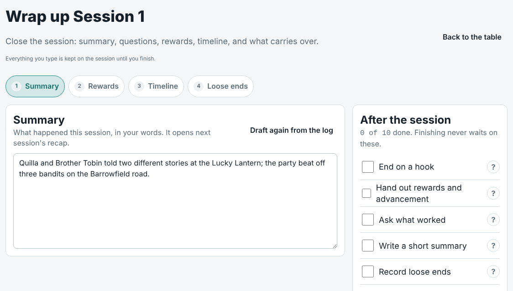

### 7.6 The next session

Finishing plans the next session and carries the loose ends into its *Plan*; it opens on that session's page, ready for its *Scenes planned* (the lair, next time). Before you start it, *Build the recap* writes a “Previously on…” from what the campaign recorded.

Between sessions, set the quest to *Completed* or *Failed* on its sheet when it is over, and level the party up from their sheets.

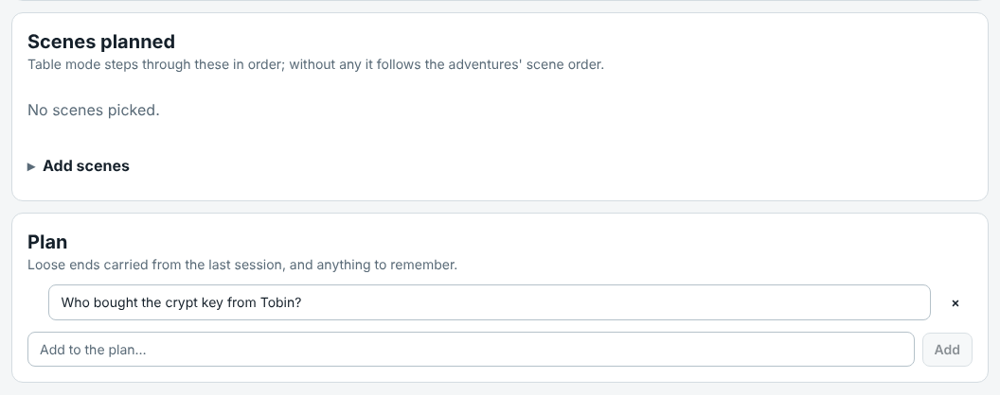
