# Your first ORC campaign

[Campaign Forge](../../README.md) · [Fantasy d20 Remaster (ORC)](../features/orc.md)

<!-- Generated by `pnpm guides` from the pf2e-orc module's guide (pf2e-orc.first-campaign); edit the module, not this page. -->

A walkthrough for campaign play, from an empty campaign to the end of session 1: the party, places and people, how to connect them, a rumour turned into an adventure with an encounter and a dungeon, and the session itself. Follow it in your own campaign; the example names are only there to show where things go.

In the app, the same guide is the **Guide** page of every Fantasy d20 Remaster (ORC) campaign (on Home, and on the setup checklist), where every step links straight to where it is done. Written for Campaign play.

## Contents

1. [Create the campaign](#1-create-the-campaign)
2. [Make the party](#2-make-the-party)
3. [Places](#3-places)
4. [People](#4-people)
5. [Connect them](#5-connect-them)
6. [An adventure](#6-an-adventure)
7. [A session](#7-a-session)

## 1. Create the campaign

One campaign holds everything: the party, the places, the quests and every session.

### 1.1 Start a campaign

On the campaign list, click *New campaign*. Give it a name (the example is The Wardens of Mossford) and choose *Fantasy d20 Remaster (ORC)* as the *Game module*. The dialog shows the module's licence and notices.

Under *Play mode*, *Campaign* is long-running play: characters gain levels over many sessions, with factions, quests and a world that moves between adventures; this guide follows it. *One-shot* is a single evening: quick characters from the builder, one adventure and a clear ending. Click *Create campaign*.

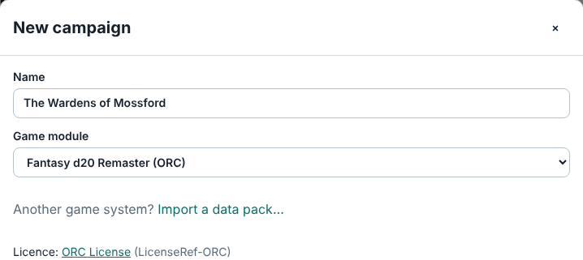

### 1.2 Meet the setup checklist

The campaign opens on *Home*, which leads with *Set up your campaign*: the player characters, the players and who plays whom, and the first session. Each step ticks itself when the campaign holds what it asks for, and its button goes straight to where it is done.

You can do them in any order, or click *Hide this*; *Settings* can show the checklist again. This guide walks the same ground and more; *Guide* on Home, or *Step-by-step guide* on the checklist, brings you back to it.

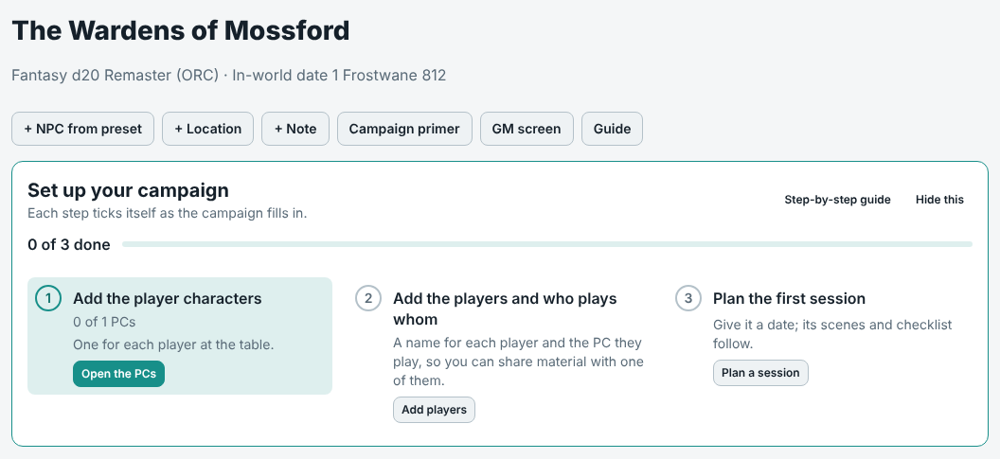

## 2. Make the party

A player character for each player, and who plays whom.

### 2.1 Build a character

Click *Open the PCs* in the checklist, then *Build a character*. The builder walks *Ancestry* (with a heritage and the ancestry's boosts), *Background*, *Class*, *Attribute boosts*, *Skills and languages*, *Starting level*, *Level by level* (each level's feats), *Equipment* and *Details*; the side summary shows the attribute modifiers, Hit Points, AC, Perception, saves and class DC that follow.

Each step says what is still missing. *Review* lists every grant with where it came from, and what is left to do by hand (here for Ilsa Varrow, a human fighter); click *Create character* and her sheet opens. *Keep for later* leaves a half-built character on the PCs tab, to resume.

*Rulebook: Player Core — Ancestries.*

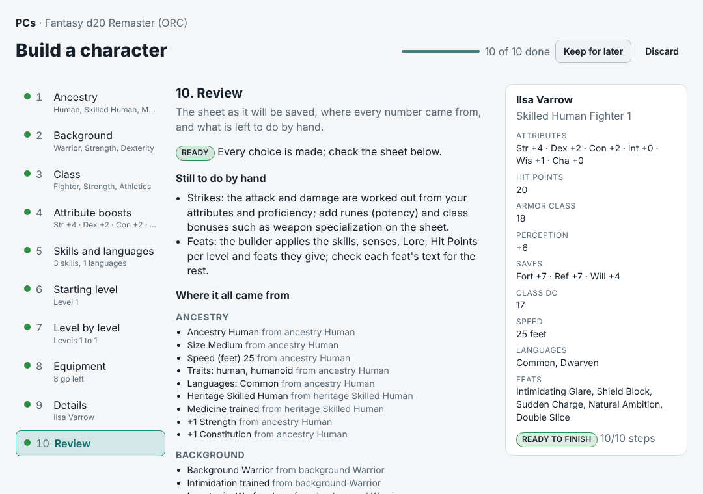

### 2.2 Or make one by hand

On the PCs tab, click *+ New* (or *+ Player character* while the tab is empty). The type is *Player character*; type a *Name* (here Tamsin Reed), keep *Blank*, and click *Create player character*.

Fill the sheet in yourself: attribute modifiers, proficiency ranks, Strikes, gear. Everything marked *computed* (check totals, AC, Hit Points, class DC, spell DC, Bulk) works itself out and is never typed in.

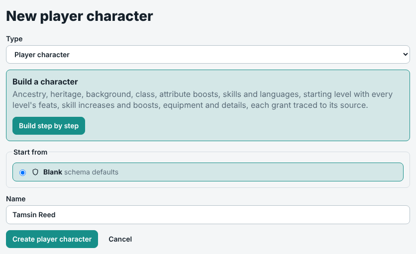

### 2.3 Add the players and who plays whom

Click *Add players* in the checklist: it opens *Settings* at *Players*. Type each player's name and click *Add player*, then tick who plays which PC (*Alex plays Ilsa Varrow*).

Players have no accounts in this version; knowing who plays whom lets you share a handout with one player and send each player a packet with their own sheet.

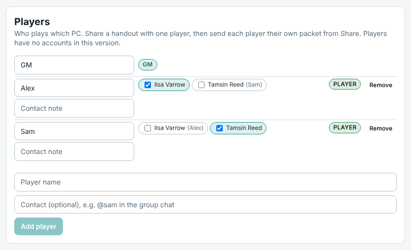

### 2.4 The character sheet

Open a PC from the Atlas's *PCs* tab. The sheet names who plays it (*Played by*); fold a section away by its title (here *Character*) to bring the next ones up: *Attribute modifiers*, then *Defense and health*, where AC and Hit Points are computed. *Level up* runs the builder again for the next level.

Click *Roll* beside a skill for a check: the roll panel takes a DC, fortune or misfortune and the multiple attack penalty, and reads all four degrees of success.

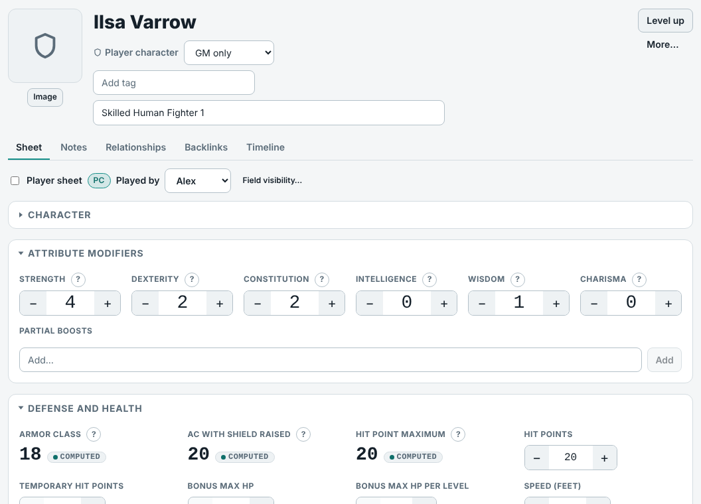

## 3. Places

Locations nest: a settlement holds a tavern, a dungeon its rooms.

### 3.1 Add a settlement

On Home, click *+ Location*. Choose a *Subtype*: *Settlement* adds size, level, population and who is in charge to the sheet, and there are *Dungeon or lair*, *Room or area*, *Wilderness*, *Building* and *Plane* too.

Name it (Mossford, the party's home town) and click *Create location*. On its page, write the one-line *Summary* under the name: what the place is, at a glance.

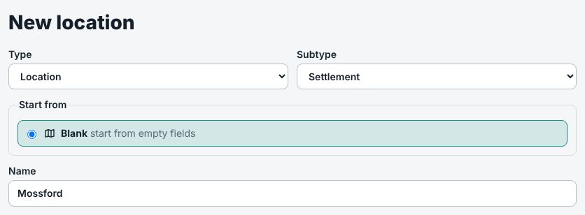

### 3.2 Put a place inside another

Make a second location, a *Building* called the Ferryman's Rest. On its page, open *Relationships*, click *+ Add relationship*, choose *within*, click *Choose…*, pick *Mossford* and click *Add*.

The Atlas's *Locations* tab now shows the inn under the town. The settlement and dungeon generators nest their places the same way.

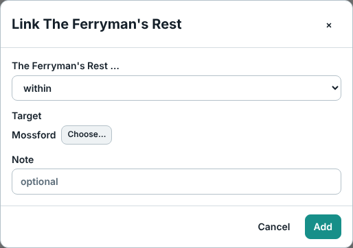

### 3.3 Or roll a settlement and its tavern

On *Generate*, open *Settlement and tavern*. Each step shows its roll: a name, a size and level, a notable feature, a local trouble, the tavern and its innkeeper. *Re-roll* or *Pin* any step; a *Seed* gives the same result every time.

The *Preview* lists what will join the campaign; rename anything there (here the village of Ivyford, the Merry Crow and its keeper Bram Oakhollow; the rumour and the tavern's text follow the new names) and click *Accept into campaign*. The tavern sits within the village, and the local trouble lands on Home's *Quest board* as a rumour.

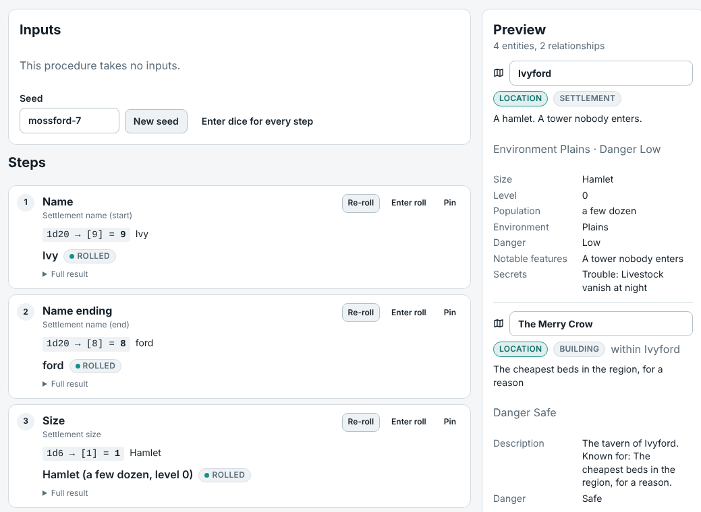

## 4. People

NPCs from Monster Core's stat blocks, from the NPC generator, or by hand.

### 4.1 An NPC from a stat block

On Home, click *+ NPC from preset*: it opens a new *Creature* with Monster Core's stat blocks to start from, people as well as monsters. *Search presets* (here “street watcher”), pick one (*Halfling Street Watcher*), name them (Corin Dale, Mossford's watch sergeant) and click *Create creature*.

The level, AC, Hit Points, saves, skills and Strikes come with the stat block, ready for the combat panel. Use one for anyone who may end up in a fight.

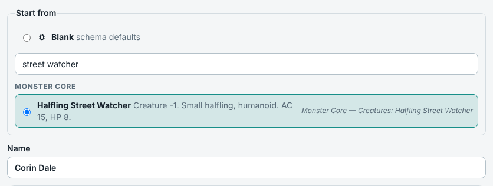

### 4.2 Roll an NPC

On *Generate*, open *NPC*: a name, an ancestry, an occupation with a Monster Core stat block to use if it comes to a fight, a quirk, a voice, what they want and what they hide. Rename them in the *Preview* (here Hesper Quill, an elf alchemist's assistant who knows a hidden way in) and click *Accept into campaign*.

*Another NPC* rolls the next one: keep a few ready, so the people the party meets by chance do not all sound alike.

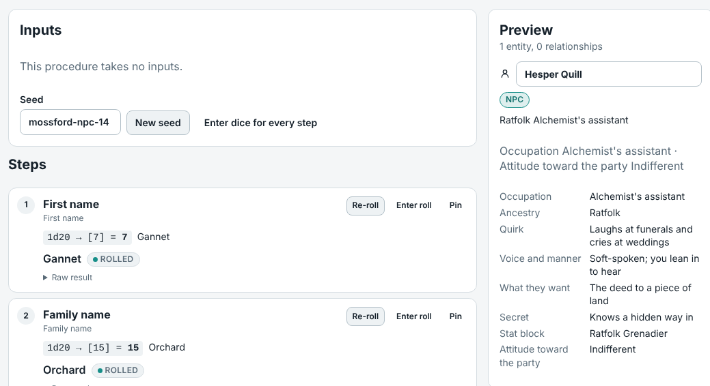

### 4.3 An NPC by hand, and the NPCs tab

On the Atlas, click *+ New*, choose *NPC* as the *Type*, name them (Odalys Brand, the reeve of Mossford) and click *Create NPC*. Write the *Summary*: one line on who they are. The sheet has room for their attitude toward the party, how to play them and a stat block to use.

The Atlas's *NPCs* tab lists everyone with an NPC sheet; creatures such as Corin Dale are on the *Creatures* tab.

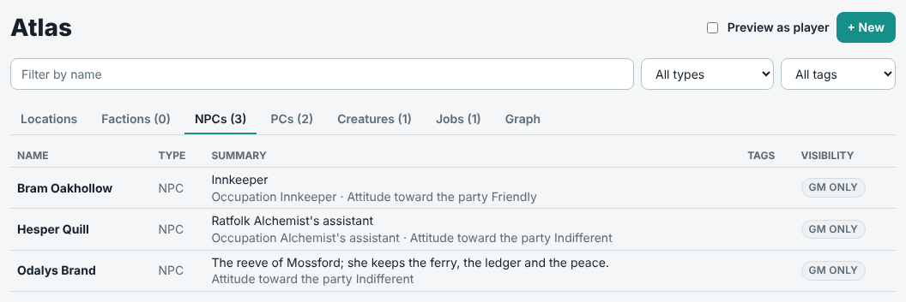

## 5. Connect them

Relationships, links in notes, and who gets to see what.

### 5.1 Add a relationship

Open an NPC (Odalys Brand), go to *Relationships* and click *+ Add relationship*. Choose how they relate (*knows*, *member of*, *owns*, *wants*, *within* and more, and this module's own *rival of* and *serves*; a creature's page also offers *lairs in* and *guards*), *Choose…* who, add a *Note* if it helps (“Pays her to watch the ferry road”) and click *Add*.

A relationship shows on both pages: Ilsa Varrow's *Relationships* tab lists Odalys Brand too.

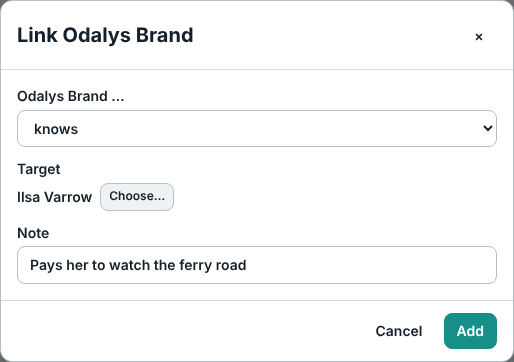

### 5.2 Link people and places in a note

On the same page, open *Notes* and click *+ Add note*. Type *@* and a few letters of a name: pick the entity from the list to link it, or make a new one on the spot with *Create “…” as…*. Scene notes, read-aloud text and the notes on Home's *+ Note* link the same way.

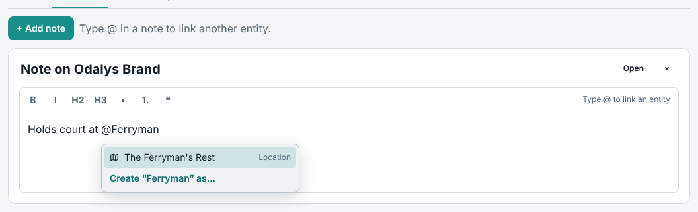

### 5.3 See what links here

Open the place you linked (the Ferryman's Rest) and its *Backlinks* tab: every note, scene, session and handout that mentions it, with how. Click one to open it.

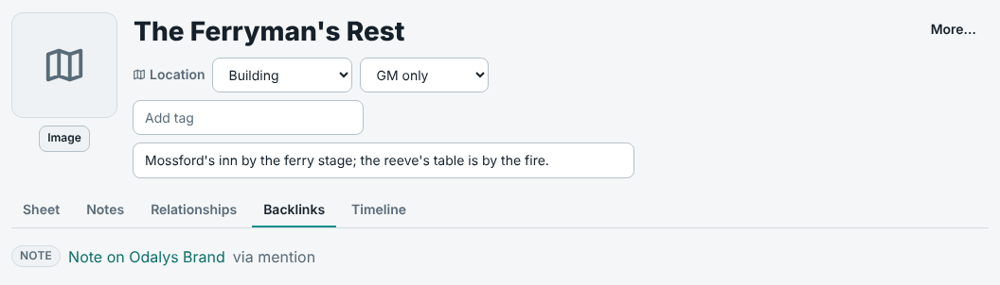

### 5.4 The graph

The Atlas's *Graph* tab draws every relationship at once, places beside people; the filters above it narrow it to a type or a tag.

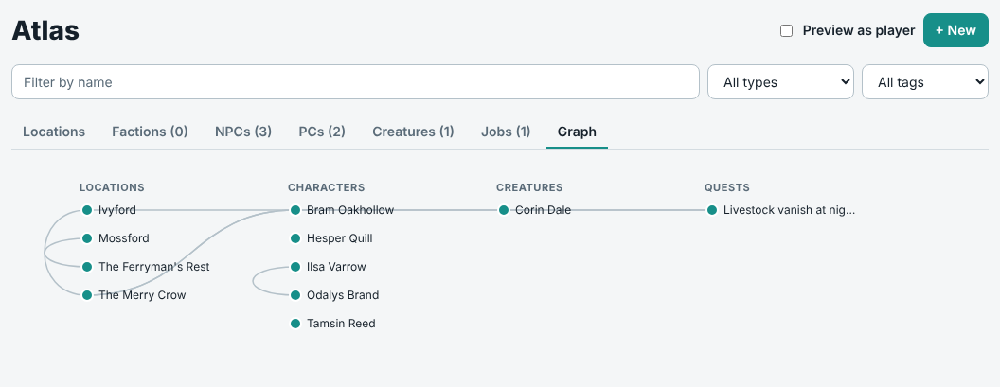

### 5.5 GM only, or for the players

Everything starts *GM only*. The select beside the type on each page sets who may see it: *Players*, *Revealed* once it has come up in play, or *Some players*; *Field visibility…* hides single fields, such as an NPC's secret.

Tick *Preview as player* on the Atlas to check: here only Mossford, set to *Players*, is left. Sharing with players and table mode's player screen follow the same rules.

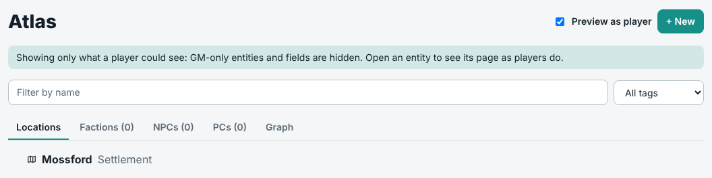

## 6. An adventure

A rumour on the quest board, an adventure from a template, an encounter and a dungeon for it.

### 6.1 A quest from the quest board

Home's *Quest board* groups the campaign's quests by status, from *Rumour* to *Completed* and *Failed*. Ivyford's local trouble is there already (“Livestock vanish at night”); *+ Quest* adds one by hand.

Open it and fill in what the party needs: the *Hook*, the *Patron* (Odalys Brand), the *Objective* and the *Reward*. Set its *Status* to *Offered* when the party hears of it and *Active* once they take it on.

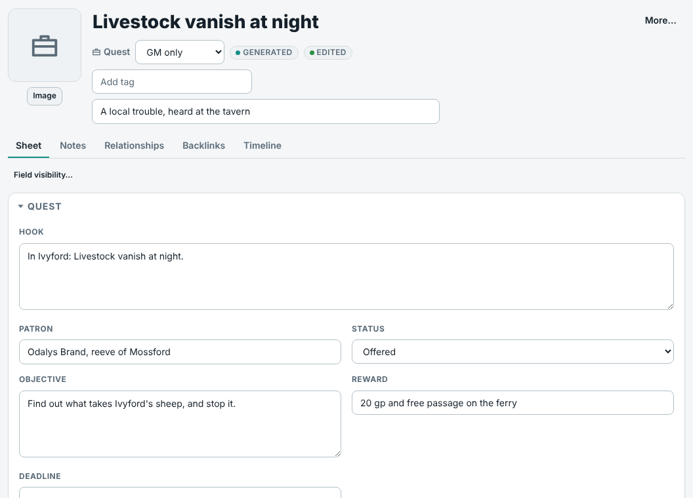

### 6.2 Start an adventure from a template

Open *Adventures* and click *New adventure*. *A short delve* gives three acts (*Rumours*, *The lair*, *Aftermath*) with their scenes; *Blank* starts empty, and *Show templates for other play modes* adds the one-shot in three acts. Give it a *Title* (here The Crowfoot Warren) and click *Create adventure*.

Write the *Player introduction* the players hear and *The situation (GM only)*: what is really going on.

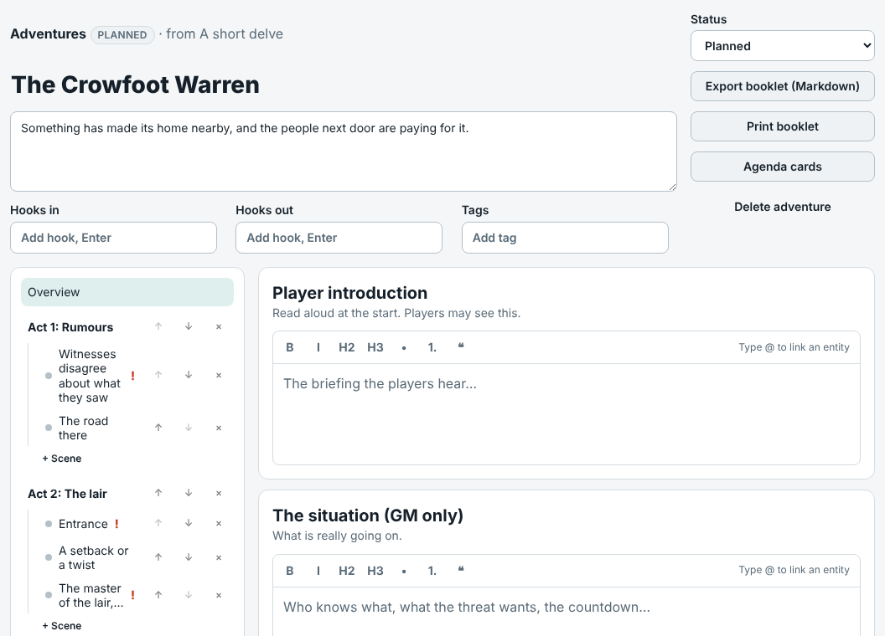

### 6.3 Put places and people in a scene

Click a scene in the outline (Act 1's first). *Location* *Pick* sets where it happens (here the Merry Crow); *Participants* *+ Add* puts NPCs, PCs and creatures in it (Bram Oakhollow and Hesper Quill). *Clues* and *Encounter* are picked the same way; *Map* is a select of the campaign's maps, with *Create map* beside it.

Below, *Events* lists what must or may happen, *Read-aloud text* is the boxed text for the players, and *Scene notes* take *@* links. Table mode shows all of it for the scene you are in.

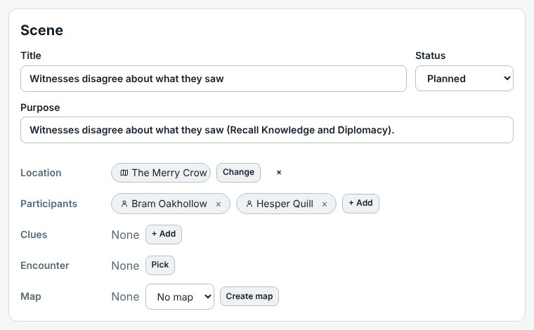

### 6.4 Build an encounter

On *Generate*, open *Encounter builder*. Set the *Party level*, *Party size* and *Threat*: it spends the XP budget for them on Monster Core creatures, then rolls what they are doing and a twist. Here two kobold warriors rest by the road, one lookout half awake. Click *Accept into campaign*: the encounter and each creature, with its stat block, join the campaign.

Back in the adventure, open the scene for it (*The road there*) and *Pick* it as the *Encounter*. Picking it does not bring its creatures along: *+ Add* them as *Participants* too, since at the table the combat panel fights whoever is in the scene.

*Rulebook: GM Core — Building Encounters.*

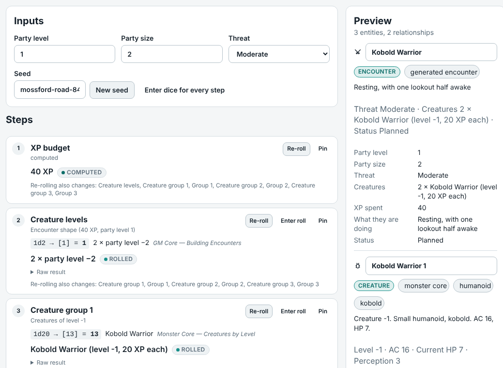

### 6.5 Generate the dungeon

On *Generate*, under *Site maps*, open *Dungeon*. Fill the brief (a *Cave or cavern*, *Small*, the party's level and size, the *Threat* and a *Theme* such as *Kobolds*), keep or type a *Seed* and click *Generate*: a map on a 5-foot grid with doors and secrets, room purposes, encounters, traps and treasure.

Name it (the Crowfoot Warren) and click *Save to campaign*: its rooms, encounters, creatures and hazards join the campaign, and the map's page has a *Player map* tab without the GM's marks. Pick it as the *Map* of the lair's scenes (here *Entrance*); at the table, the player screen shows only the rooms the party has found.

*Rulebook: GM Core — Building Encounters.*

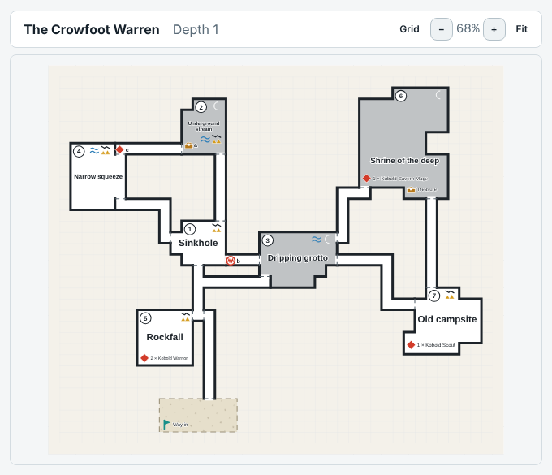

### 6.6 Add a handout

Click an act in the outline (Act 1) and, under *Handouts*, *+ Handout*. Title it (here “A letter from the reeve”), open it to write the text or add an image, and leave it *GM only*: you reveal it at the table. *+ Personal handout* adds a handout for one character, which goes to that player alone.

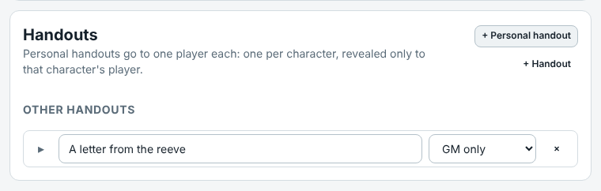

## 7. A session

Plan it, run it at the table, wrap it up; the next one is planned for you.

### 7.1 Plan the session

Click *Plan a session* in the checklist: it opens *Sessions*, where *Plan next session* makes session 1. *Scenes planned* is what table mode steps through, in order: open *Add scenes* and click *+ Plan* beside each scene (or *Add all* for an act); reorder or remove them. Under *Plan*, add what to remember (“Hesper knows a hidden way into the warren”).

The *Session checklist* adds this module's own reminders: levels and spell slots, tonight's encounter budgets, three names ready.

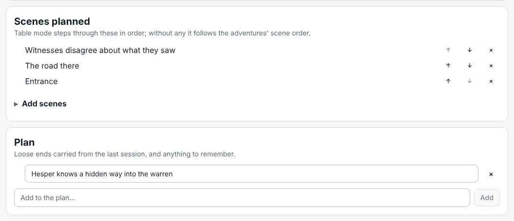

### 7.2 Start it: table mode and combat

Click *Start this session* on Home. Table mode shows the scene you are in with its read-aloud text, events and participants; *Mark run* or *Skip* it and *Next →* moves on. The clock's *+ Round*, *+ Minute* and *+ Hour* keep time, and the tabs hold the trackers (dying, wounded, doomed, Hero Points, conditions), dice, hints, the checklist and the log.

In a scene with creatures, the *Combat* panel's *Roll initiative for everyone* sorts the order; each card takes *Damage*, *Heal* and *+ Condition*, *Attack* rolls a Strike against AC with all four degrees (a PC's Strikes work out their attack and damage from the sheet), and *Next turn* moves on.

*Rulebook: Player Core — Encounter Mode: Initiative.*

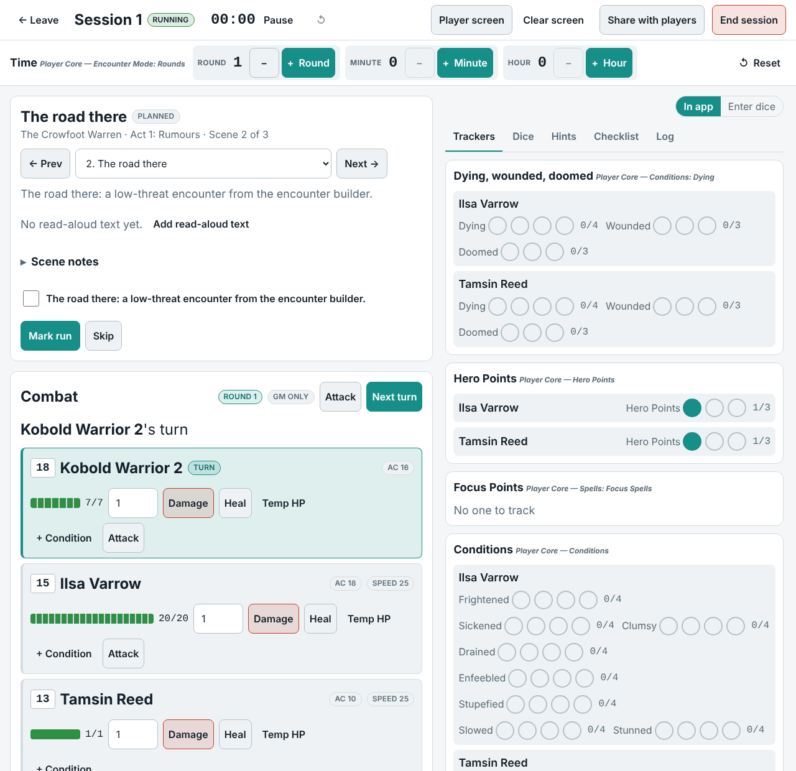

### 7.3 Reveal a handout

In the *Reveal* panel, click *Reveal* beside a handout of the scene, act or adventure: it goes on the *Player screen* (a second window for the players) and counts as revealed from now on. *Pin* keeps it there, *Clear the screen* takes everything down.

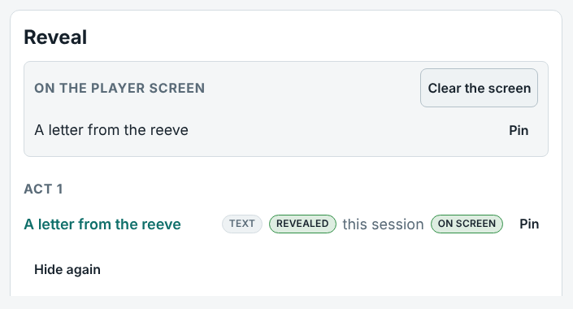

### 7.4 Wrap up

Click *End session*. The wrap-up walks *Summary* (a draft from what the session logged, to edit into your words; *Draft again from the log* starts over), *Rewards*, *Timeline* and *Loose ends*, beside the *After the session* checklist with this module's reminders: clear conditions, award experience points, record treasure. Everything you type is kept as you go. Click *Finish session*.

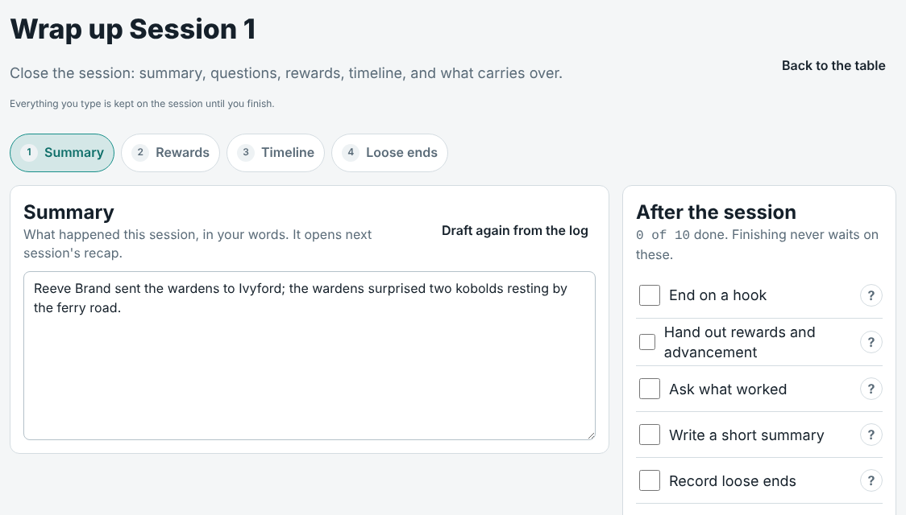

### 7.5 The next session

Finishing plans the next session and carries the loose ends into its *Plan*; it opens on that session's page, ready for its *Scenes planned*. Before you start it, *Build the recap* writes a "Previously on…" from what the campaign recorded.

Between sessions, the *Campaign primer* on Home is the players' introduction to the campaign, and *GM screen* is the module's quick reference, on screen or printed.

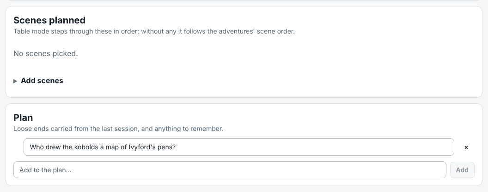
